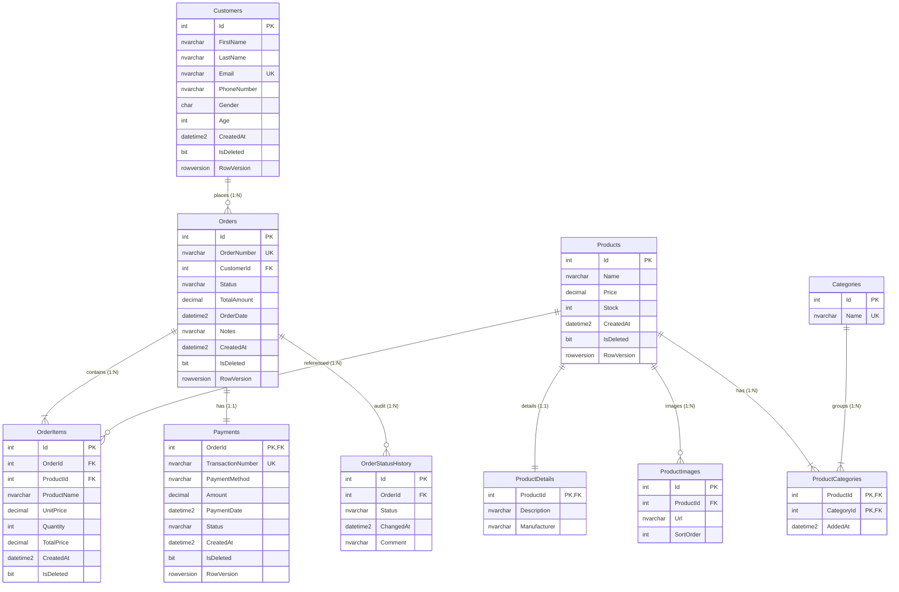
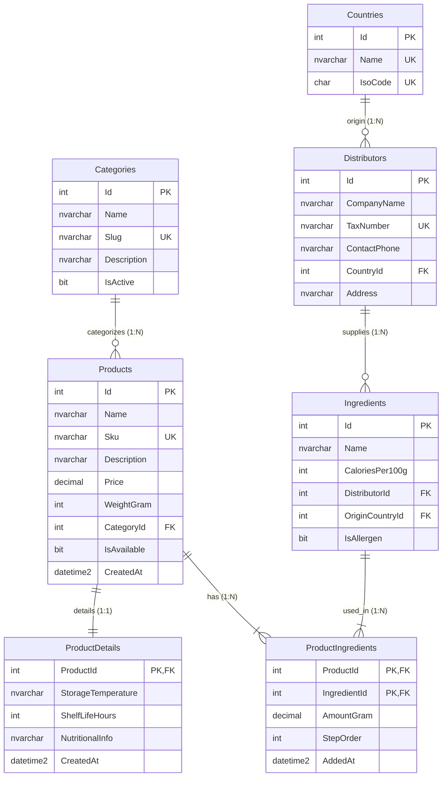
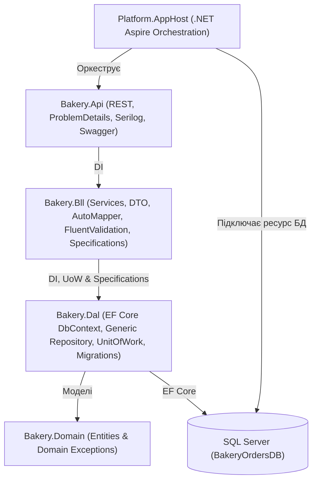

# Craft Bakery Platform — Платформа крафтової пекарні

Навчальний семестровий проєкт із дисципліни **«Технології .NET у веб-інженерії»**.
Викладач: **Томка Ю.Я.** | Студент: **Казімір В.І.** (група 443-2).

---

## 1. Опис предметної області та архітектури

Проєкт являє собою розподілену систему для крафтової пекарні **«Craft Bakery»**, що забезпечує автоматизацію прийому онлайн-замовлень свіжої випічки, управління асортиментом та технологічними картами (рецептурою), а також збір і модерацію відгуків покупців.

Система спроєктована на базі патерну **Database-per-Service** і розділена на три незалежні контексти:
1. **Orders Context (Замовлення та клієнти):** реляційна БД `BakeryOrdersDB` (SQL Server, доступ через **EF Core 10, Code-First**).
   - **Сутності:** `Customers`, `Orders`, `OrderItems`, `Payments`, `OrderStatusHistory`, `Products`, а також довідкові `Categories`, `ProductCategories`, `ProductDetails` (1:1), `ProductImages`.
2. **Catalog Context (Каталог та рецептура):** реляційна БД `BakeryCatalogDB` (SQL Server).
   - **Сутності:** `Countries`, `Categories`, `Products`, `ProductDetails` (1:1), `Distributors`, `Ingredients`, `ProductIngredients` (M:N).
3. **Reviews Context (Відгуки покупців):** документоорієнтована NoSQL БД `BakeryReviewsDB` (MongoDB).
   - **Колекції:** `reviews`, `product_ratings`, `moderation_logs`.

> [!IMPORTANT]
> Між базами даних **відсутні фізичні зв'язки FOREIGN KEY**. Усі міжсервісні посилання здійснюються за числовими ідентифікаторами (`Id`), що гарантує повну незалежність розгортання та автономність кожного мікросервісу.

> [!NOTE]
> У межах лабораторної №3 доменну модель розширено довідковими сутностями каталогу (`Category`, `ProductCategory`, `ProductDetail`, `ProductImage`) — щоб продемонструвати зв'язки 1:1 та M:N у Fluent API. Фізично вони зберігаються в `BakeryOrdersDB`; винесення в окремий Catalog-сервіс — окремий крок курсу.

---

## 2. Політика дублювання даних між базами (Data Duplication Policy)

| Поле / Дані | База-власник (Master) | Де дублюється (Replica) | Мета дублювання | Механізм підтримки узгодженості |
|---|---|---|---|---|
| `UnitPrice` (Ціна товару) | `BakeryCatalogDB.Products` | `BakeryOrdersDB.OrderItems` | Фіксація суми покупки: зміна ціни в каталозі не впливає на старі чеки | **Знімок (Snapshot):** копіюється в момент створення замовлення |
| `ProductName` (Назва товару) | `BakeryCatalogDB.Products` | `BakeryOrdersDB.OrderItems` | Автономність друку чеків та звітів без мережевих запитів до каталогу | **Знімок (Snapshot):** копіюється в момент покупки |
| `Products.Name, Price` | `BakeryCatalogDB.Products` | `BakeryOrdersDB.Products` | Локальна копія довідника товарів для швидкого оформлення кошика та перевірки наявності | **Подієва узгодженість (Eventual Consistency):** подія `ProductCatalogUpdatedEvent` |
| `ProductName` (Назва товару) | `BakeryCatalogDB.Products` | `BakeryReviewsDB.reviews` | Швидка видача списку відгуків клієнту без міжсервісних Join | **Подієва узгодженість (Eventual Consistency):** подія `ProductRenamedEvent` |
| `CustomerName` (Ім'я клієнта) | `BakeryOrdersDB.Customers` | `BakeryReviewsDB.reviews` | Відображення автора відгуку без звернення до бази клієнтів | **Подієва узгодженість (Eventual Consistency):** подія `CustomerProfileUpdatedEvent` |

---

## 3. Діаграми сутностей (ERD)

### 3.1. Діаграма Проєкту №1 (Orders Context — BakeryOrdersDB)

Зв'язки: 1:1 (`Orders` $\leftrightarrow$ `Payments`, `Products` $\leftrightarrow$ `ProductDetails`), 1:N (`Customers` $\rightarrow$ `Orders`, `Orders` $\rightarrow$ `OrderItems`, `Orders` $\rightarrow$ `OrderStatusHistory`), M:N (`Orders` $\leftrightarrow$ `Products` через `OrderItems`; `Products` $\leftrightarrow$ `Categories` через `ProductCategories`).



### 3.2. Діаграма Проєкту №2 (Catalog Context — BakeryCatalogDB)
Зв'язки: 1:1 (`Products` $\leftrightarrow$ `ProductDetails`), 1:N (`Categories` $\rightarrow$ `Products`, `Countries` $\rightarrow$ `Distributors`), M:N (`Products` $\leftrightarrow$ `Ingredients` через `ProductIngredients` з власним полем `AmountGram`).



---

## 4. Розгортання баз даних

### 4.1. SQL-скрипти (лабораторна №1)

Скрипти згруповані у каталозі `db/`:
```text
db/
├── p1/    # Проєкт №1 (Orders): schema.sql · procedures.sql · seed.sql
├── p2/    # Проєкт №2 (Catalog): schema.sql · seed.sql
└── p3/    # Проєкт №3 (MongoDB): collections.js · seed.js
```

```sql
:r db/p1/schema.sql        -- таблиці, зв'язки, індекси
:r db/p1/procedures.sql    -- збережувані процедури (State Machine статусів)
:r db/p1/seed.sql          -- ідемпотентний сід
:r db/p2/schema.sql
:r db/p2/seed.sql
```

### 4.2. MongoDB (лабораторна №1 → сервіс `Reviews`)

Контейнер з **одно-вузловим репліка-сетом** `rs0`, бо транзакції MongoDB існують лише на репліка-сеті:

```bash
docker run -d --name bakery-reviews-mongo -p 27017:27017 \
  --entrypoint mongod mongo:7 --replSet rs0 --bind_ip_all

docker exec bakery-reviews-mongo mongosh --quiet --eval "rs.initiate()"

# учасника реплікації прив'язуємо до імені, яке резолвиться з хост-машини:
docker exec bakery-reviews-mongo mongosh --quiet --eval "var c = rs.conf(); c.members = [{ _id: 0, host: 'localhost:27017' }]; rs.reconfig(c, { force: true })"
```

Ручні скрипти лабораторної №1 (схема `$jsonSchema` і демо-дані):

```bash
mongosh BakeryReviewsDB db/p3/collections.js
mongosh BakeryReviewsDB db/p3/seed.js
```

> [!NOTE]
> Від лабораторної №4 скрипти запускати не обов'язково: сервіс `Reviews` на старті сам створює всі
> індекси (`MongoIndexInitializer`) та ідемпотентно наповнює колекції (`MongoDataSeeder`), а документна
> структура точно збігається з `db/p3/collections.js` (.camelCaseElementName, без атрибутів у домені).

### 4.3. Міграції EF Core (лабораторна №3)

Схема Orders-сервісу тепер керується **EF Core Code-First**: 10 конфігурацій `IEntityTypeConfiguration<T>`
(Fluent API: PK/FK, check-constraints, unique-індекси, `rowversion`, 1:1 та M:N) і одна міграція `InitialCreate`.

```bash
# створити нову міграцію
dotnet ef migrations add <Name> \
  --project Services/Bakery/Bakery.Dal \
  --startup-project Services/Bakery/Bakery.Api

# застосувати до БД (також виконується автоматично при старті застосунку)
dotnet ef database update \
  --project Services/Bakery/Bakery.Dal \
  --startup-project Services/Bakery/Bakery.Api

# згенерувати SQL-скрипт міграції
dotnet ef migrations script \
  --project Services/Bakery/Bakery.Dal \
  --startup-project Services/Bakery/Bakery.Api
```

Міграція застосовується у `Program.cs` через `MigrateAsync()`; у Development після неї виконується
ідемпотентний сід (`DbInitializer`): 3 товари, 2 клієнти та зв'язки `ProductCategory` (кожен товар — у двох
категоріях; сід пропускає створення зв'язків, якщо вони вже є), категорії — через `InsertData` у міграції.

> [!IMPORTANT]
> Якщо `BakeryOrdersDB` уже створена скриптами лаби 1/2, у ній немає `__EFMigrationsHistory`,
> і `MigrateAsync()` завершиться помилкою `There is already an object named 'Customers'`.
> Застосунок перевіряє це на старті та кидає зрозуміле повідомлення. Перед першим запуском видаліть базу:
>
> ```bash
> dotnet ef database drop -f \
>   --project Services/Bakery/Bakery.Dal \
>   --startup-project Services/Bakery/Bakery.Api
> ```
>
> Дані лаби 1/2 відтворюються скриптами `db/p1`–`db/p2` та сідом EF Core.

---

## 5. Архітектура сервісу `Bakery` (лабораторні №2–3)

- **`Bakery.Domain`**: доменні моделі з інкапсуляцією (`Customer`, `Order`, `OrderItem`, `Payment`, `Product`,
  `OrderStatusHistory`, `Category`, `ProductCategory`, `ProductDetail`, `ProductImage`) та доменні винятки
  (`NotFoundException`, `BusinessConflictException`, `ValidationException`, `DomainValidationException`).
  Жодних залежностей від EF Core чи ASP.NET.
- **`Bakery.Dal`** (Data Access Layer):
  - `BakeryDbContext` + `ApplyConfigurationsFromAssembly` (Fluent API) та `Migrations/`.
  - `GenericRepository<T>` — асинхронний CRUD (`GetByIdAsync`, `GetAllAsync`, `AddAsync`, `Update`, `Delete`,
    `CountAsync`) і читання за специфікацією (`ListAsync(ISpecification<T>)`, `CountAsync(ISpecification<T>)`,
    `WithSpecification(ISpecification<T>, applyPaging)` — та сама вибірка, але як `IQueryable<T>`, щоб
    викликаний міг добудувати own LINQ поверх оцінених `Where`/`Include`/`OrderBy`/`Skip`/`Take`).
  - Спеціалізовані репозиторії: `CustomerRepository`, `OrderRepository`, `PaymentRepository`, `ProductRepository`.
  - `OrderRepository.GetWithDetailsAsync` — **eager loading** (`Include`/`ThenInclude`);
    `GetWithExplicitPaymentAsync` — **explicit loading** через `Reference` (`Entry(...).Reference(...).LoadAsync`);
    `GetWithExplicitStatusHistoryAsync` — **explicit loading** через `Collection`
    (`Entry(...).Collection(x => x.StatusHistory).LoadAsync(ct)`);
    `ProductRepository.GetCategoryLinksAsync` — LINQ над проміжною сутністю `ProductCategory` (M:N) з
    фільтром по `AddedAt` і `Include` обох навігацій.
  - `UnitOfWork` (єдина точка `SaveChangesAsync` і транзакцій) та `SpecificationEvaluator`.
- **`Bakery.Bll`** (Business Logic Layer): `CustomerService`, `OrderService`, `PaymentService`, `ProductService`;
  DTO (`CreateCustomerRequest`, `CreateOrderRequest`, `OrderQuery`, `PagedResponse<T>`, `OrderStatusHistoryDto`,
  `ProductInCategoryDto` тощо); AutoMapper-профіль; валідатори FluentValidation (реєструються в DI і
  **випускаються з DI в конструкторі сервісу**, виклик — `ValidateAndThrowAsync`); `CustomerOrdersSpecification`.
- **`Bakery.Api`** (Presentation): тонкі асинхронні контролери (`CustomersController`, `OrdersController`,
  `PaymentsController`, `ProductsController`), коректні коди відповідей, Swagger,
  `GlobalExceptionHandlerMiddleware` (ProblemDetails / ValidationProblemDetails), `CorrelationIdMiddleware`, Serilog.
- **`Platform.AppHost`**: .NET Aspire оркестратор (API + SQL Server).



### 5.1. Specification pattern

Складна логіка вибірки винесена з репозиторію в окремий клас `CustomerOrdersSpecification`
(критерій, `Include`, сортування, `Skip`/`Take`). Репозиторій приймає специфікацію як параметр,
`SpecificationEvaluator` транслює її в LINQ-вираз для EF Core:

```csharp
var specification = new CustomerOrdersSpecification(customerId, query.Status, page, pageSize, query.SortBy, query.Desc);
var entities = await uow.Orders.ListAsync(specification, ct);
var total = await uow.Orders.CountAsync(specification, ct);
```

Специфікація залежить лише від `System.Linq.Expressions`, тому її можна тестувати окремо від EF.

`GenericRepository.WithSpecification` віддає ту саму вибірку як `IQueryable<T>` — це той самий
`SpecificationEvaluator`, але викликаний може дошарувати own LINQ (напр. `.Select(...)` у DTO) до того,
як запит піде в базу:

```csharp
public virtual IQueryable<T> WithSpecification(ISpecification<T> specification, bool applyPaging = true) =>
    SpecificationEvaluator.GetQuery(Set.AsNoTracking(), specification, applyPaging);
```

### 5.2. Пагінація, фільтрація, сортування

`GET /api/v1/orders/customer/{customerId}` приймає:

| Параметр | Значення за замовчуванням | Опис |
|---|---|---|
| `page` | `1` | номер сторінки (мінімум 1) |
| `pageSize` | `10` | розмір сторінки (1…100) |
| `status` | — | фільтр за статусом замовлення |
| `sortBy` | `orderDate` | `orderDate` \| `totalAmount` \| `status` |
| `desc` | `true` | напрямок сортування |

Відповідь: `items`, `page`, `pageSize`, `totalCount`, `totalPages`, `hasNext`, `hasPrevious`.

### 5.3. Валідація

Два рівні й два місця виклику:

- **DataAnnotations на DTO** (`[Required]`, `[Range]`, `[EmailAddress]`, `[RegularExpression]`) — перевіряє
  сам MVC перед входом у метод контролера (`ApiController` + ModelState), тому грубо некоректне тіло
  запиту відсікається ще до бізнес-логіки.
- **FluentValidation у BLL** — валідатори реєструються одним рядком `AddValidatorsFromAssembly(...)`
  (без `AddFluentValidationAutoValidation`: авто-валідація — це легасі-шлях, який забирає помилки до
  middleware і не залишає BLL перевіряти між об'єктами). Сервіс отримує `IValidator<TRequest>`
  у конструктор і викликає `await validator.ValidateAndThrowAsync(request, ct)` **перед** зверненням до
  бази, тож бізнес-правила формату перевіряються там, де вони належать до бізнес-логіки.

| Валідатор | Додатково до атрибутів |
|---|---|
| `CreateCustomerRequestValidator`, `UpdateCustomerRequestValidator` | `EmailAddress()`, `PhoneNumber` обов'язковий, вік 14…120 |
| `CreateOrderRequestValidator` | рядки `Items` не порожні + **один товар не може бути у двох рядках** (правила немає в атрибутах) |
| `CreateOrderItemRequestValidator` | `ProductId > 0`, `Quantity` 1…100 |
| `UpdateOrderStatusRequestValidator` | `NewStatus` має бути серед шести дозволених значень |
| `ProcessPaymentRequestValidator` | `OrderId > 0`, `Amount > 0` |

Помилки будь-якого з двох рівнів приводяться до одного формату: `400` +
`ValidationProblemDetails` (`type`, `title`, `status`, `errors: { поле: [повідомлення] }`).

### 5.4. Централізована обробка помилок

`GlobalExceptionHandlerMiddleware` перехоплює всі невиловлені винятки та повертає `ProblemDetails`:

| Виняток | HTTP |
|---|---|
| `NotFoundException` | 404 |
| `BusinessConflictException` | 409 |
| `ValidationException`, `DomainValidationException`, `ArgumentException` | 400 — `ValidationProblemDetails` із словником `errors` |
| `FluentValidation.ValidationException` | 400 — `ValidationProblemDetails`, ключі — `PropertyName` невдалих правил |
| `DbUpdateException` / `DbUpdateConcurrencyException` | 409 |
| інші | 500 (деталі — лише в Development) |

Для 400 серіалізація робиться явно через `JsonSerializer.Serialize(details, details.GetType(), …)`:
без передачі фактичного типу `errors` не потрапив би на верхній рівень, бо `ValidationProblemDetails`
наслідується від `ProblemDetails`.

### 5.5. Логування (Serilog)

Serilog налаштований у `Program.cs` та `appsettings.json` (рівні, console sink, output template).
Кожен запит логується через `UseSerilogRequestLogging` (метод, шлях, статус, тривалість).
`CorrelationIdMiddleware` додає до всіх логів `CorrelationId` (з заголовка `X-Correlation-Id` або
`TraceIdentifier`) та `UserId` (з `X-User-Id`, якщо переданий), а також повертає `X-Correlation-Id`
у відповіді.

---

## 6. Архітектура сервісу `Reviews` (лабораторна №4)

Чиста архітектура + CQRS. Напрямок залежностей — ззовні всередину; середні шари не знають ні про
HTTP, ні про MongoDB Driver.

| Проєкт | Залежить від | Що покладено |
|---|---|---|
| `Reviews.Domain` | нічого (тільки пакет `MongoDB.Bson` задля `ObjectId`) | `BaseEntity`, базовий `ValueObject`, сутності `Review`/`ProductRating`/`ModerationLog`, VO `Rating`/`PersonName`/`ReviewComment`/`AdminResponse`, enum-и, доменні винятки, інтерфейси репозиторіїв і `IMongoUnitOfWork` |
| `Reviews.Application` | `Reviews.Domain` | команди з окремими класами-обробниками, Queries через `IReviewQueries`, конвеєр біхавіорів MediatR, валідатори FluentValidation, `MappingProfile` AutoMapper, `AddApplication()` |
| `Reviews.Infrastructure` | `Reviews.Application`, `Reviews.Domain` | `MongoDbContext`, реєстрація `BsonClassMap` + конвенції, репозиторії на MongoDB.Driver, транзакції, створення індексів, ідемпотентний сід, health check, `AddInfrastructure()` |
| `Reviews.WebApi` | `Reviews.Application`, `Reviews.Infrastructure` | контролери, які роблять лише `ISender.Send(...)`, ETag/If-Match, ProblemDetails, Swagger, Serilog, DI-композиція |

Шлях запиту: контролер → `ISender` → біхавіори (ззовні всередину: `ExceptionHandling` → `Validation`
→ `Logging` → `Caching` → `Performance`) → обробник → репозиторій / `IReviewQueries` → MongoDB.

Ключові рішення:

- **Мапінг без атрибутів у домені.** Конвенції (`CamelCaseElementNameConvention`,
  `IgnoreExtraElementsConvention`) та `BsonClassMap` реєструються в Infrastructure; домен лишається
  чистим, а приватне поле `tags` мапиться через `SetElementName("tags")`.
- **Незмінні VO + інкапсуляція.** Властивості тільки з `private set`; зміни — через методи
  `UpdateContent`, `Approve`, `Reject`, `Flag`, `AddAdminResponse`, кожен із захистом інваріантів.
- **Denormalized `averageRating`.** Окрім вкладеного `ratings`, у документі лежить обчислене
  `averageRating` — саме воно дає MongoDB сортувати й сторінкувати за рейтингом без `$unwind`.
- **Cursor-пагінація на боці MongoDB.** `$match` + `$sort` + `$limit(N+1)` виконуються сервером;
  токен курсора — `{sortValue}_{hexId24}` із `_id` як tie-breaker, тож сторінки не «зсуваються» при
  однакових `createdAt`.
- **Optimistic concurrency.** Кожен документ має `version`; оновлення/видалення фільтрує за
  `_id + version`, і якщо `MatchedCount == 0` — `ConflictException` → `409`. Зовні це ETag `W/"n"`
  та заголовок `If-Match`.
- **Транзакція там, де кількох документів.** Модерація й видалення пишуть у `reviews`,
  `moderation_logs` і `product_ratings` одним атомарним блоком; якщо сервер не підтримує транзакції
  (standalone), `MongoUnitOfWork` логує це й виконує роботу без транзакційного обгортання.
- **Один шар доступу до сесії.** `MongoDbContext.Session` повертає сесію транзакції, якщо вона
  активна, інакше — сесіюScoped-запиту; завдяки цьому репозиторії не знають про транзакції.
- **Кеш читань.** `CachingBehavior` кешує лише Queries, які реалізують `ICacheableQuery`
  (наприклад, рейтинг товару, TTL 60 с).

Ендпоінти:

| Метод | Шлях | Призначення |
|---|---|---|
| GET | `/api/v1/reviews` | список із фільтрами (`productId`, `customerId`, `status`, `minAverage`, `tag`, `sort`, `descending`, `cursor`, `limit`) |
| GET | `/api/v1/reviews/search?text=` | повнотекстовий пошук (`$text`) |
| GET | `/api/v1/reviews/{id}` | відгук + ETag |
| POST | `/api/v1/reviews` | створення (201 + Location + ETag) |
| PUT | `/api/v1/reviews/{id}` | оновлення тексту/оцінок/тегів (If-Match) |
| DELETE | `/api/v1/reviews/{id}` | видалення + перерахунок рейтингу (If-Match) |
| PUT | `/api/v1/reviews/by-product/{productId}` | денормалізована зміна назви товару |
| PUT | `/api/v1/reviews/by-customer/{customerId}` | денормалізована зміна імені клієнта |
| POST | `/api/v1/moderation/reviews/{id}` | модерація (Approve/Reject/Flag) у транзакції |
| POST | `/api/v1/moderation/reviews/{id}/admin-response` | відповідь адміністратора |
| GET | `/api/v1/moderation/logs` | журнал модерації (cursor) |
| GET | `/api/v1/product-ratings/{productId}` | рейтинг товару (кеш 60 с) |
| GET | `/health` | health check MongoDB |

### 6.1. Залежності й чистота збірки

`dotnet build Platform.slnx` дає **0 Warning(s), 0 Error(s)** без жодного `<NoWarn>` у `.csproj`.
Попередження NuGet-аудиту (NU1902/NU1903) закрите оновленням залежностей, а не заглушеням:

| Пакет | Було | Стало | Причина |
|---|---|---|---|
| `MongoDB.Driver` / `MongoDB.Bson` | 3.7.0 | 3.13.0 | транзитивні `Snappier` 1.0.0 (GHSA-pggp-6c3x-2xmx) і `SharpCompress` 0.30.1 (GHSA-6c8g-7p36-r338); у 3.13.0 — 1.3.1 та 0.48.1 |
| `AutoMapper` | 13.0.1 | 16.2.0 | CVE-2026-32933 — DoS через неконтрольовану рекурсію (high, CVSS 7.5); пропатчено від 15.1.1 |
| `Aspire.Hosting.*` | 9.0.0 | 13.6.4 | транзитивний `KubernetesClient` 15.0.1 (GHSA-w7r3-mgwf-4mqq); у 13.6.4 — 19.0.2 |
| `System.Security.Cryptography.Pkcs` / `.Xml` | — | 10.0.14 (прямі `PackageReference` у `Bakery.Dal`) | транзитиви `Microsoft.Data.SqlClient` (Pkcs 9.0.4) та інструмента `EF Core Design` (Xml 9.0.0); пряма версія перекриває уразливу в графі |

У коді змінився рівно один виклик: `AddAutoMapper(assembly)` → `AddAutoMapper(cfg => cfg.AddMaps(assembly))`
(`Reviews.Application/DependencyInjection.cs`, `Bakery.Api/Program.cs`) — це єдиний API-злам оновлення
AutoMapper; `Profile`, `CreateMap`, `ForMember` й `IMapper` не змінилися.
Ліцензія AutoMapper з 15-ї версії — RPL1.5 (комерційне використання за ключем); без ключа
бібліотека працює в режимах development/testing і логує одне попередження при першому мапінгу.

---

## 7. Запуск

### Через .NET Aspire
```bash
dotnet run --project Platform.AppHost/Platform.AppHost.csproj
```
Aspire піднімає SQL Server у контейнері та API; адреса Aspire Dashboard і порти сервісів
друкуються в консолі запуску.

### API окремо
```bash
dotnet run --project Services/Bakery/Bakery.Api/Bakery.Api.csproj
```
- HTTP: `http://localhost:5172`
- HTTPS: `https://localhost:7236`
- Swagger UI: `http://localhost:5172/swagger`

### Сервіс `Reviews` окремо
```bash
dotnet run --project Services/Reviews/Reviews.WebApi --launch-profile http
```
- HTTP: `http://localhost:5180`
- HTTPS: `https://localhost:7280`
- Swagger UI: `http://localhost:5180/swagger/index.html`, openapi: `/swagger/v1/swagger.json`
- In-memory: MongoDB (`mongodb://localhost:27017`, див. п. 4.2) — на старті сервіс створює індекси
  й ідемпотентно сієть демо-дані; якщо MongoDB недоступна, сервіс стартує, `/health` показує
  `Unhealthy`, а запити отримують `503` у форматі ProblemDetails.

---

## 8. Приклади запитів

1. **Створення клієнта (201 Created):**
```bash
curl -X POST http://localhost:5172/api/v1/customers \
  -H "Content-Type: application/json" \
  -d '{
    "firstName": "Оксана",
    "lastName": "Бондар",
    "email": "oksana.bondar@example.com",
    "phoneNumber": "0981122334",
    "gender": "F",
    "age": 26
  }'
```

2. **Список клієнтів (200 OK):**
```bash
curl http://localhost:5172/api/v1/customers
```

3. **Оформлення замовлення (201 Created, знімок ціни з БД):**
```bash
curl -X POST http://localhost:5172/api/v1/orders \
  -H "Content-Type: application/json" \
  -d '{
    "customerId": 1,
    "items": [
      { "productId": 1, "quantity": 2 },
      { "productId": 3, "quantity": 1 }
    ],
    "notes": "Прохання упакувати в еко-пакет"
  }'
```

4. **Замовлення з деталями (eager loading):**
```bash
curl http://localhost:5172/api/v1/orders/1
```

5. **Пагінація + фільтр + сортування:**
```bash
curl "http://localhost:5172/api/v1/orders/customer/1?page=1&pageSize=5&sortBy=totalAmount&desc=false"
```

6. **Оплата замовлення (201 Created; сума має дорівнювати `totalAmount`):**
```bash
curl -X POST http://localhost:5172/api/v1/payments \
  -H "Content-Type: application/json" \
  -d '{ "orderId": 1, "paymentMethod": "ApplePay", "amount": 280.00 }'
```
Повторна оплата того ж замовлення → `409 Conflict`.

7. **Зміна статусу (State Machine; недозволений перехід → 409):**
```bash
curl -X PATCH http://localhost:5172/api/v1/orders/1/status \
  -H "Content-Type: application/json" \
  -d '{ "newStatus": "Baking" }'
```

8. **Перевірка ProblemDetails (404):**
```bash
curl http://localhost:5172/api/v1/orders/99999
```

9. **Передача CorrelationId у логи:**
```bash
curl -H "X-Correlation-Id: demo-123" http://localhost:5172/api/v1/customers
```

10. **Історія статусів (explicit loading, `Collection(...).LoadAsync`):**
```bash
curl http://localhost:5172/api/v1/orders/1/history
```

11. **Товари категорії через проміжну сутність M:N + фільтр за `AddedAt`:**
```bash
curl "http://localhost:5172/api/v1/products/category/1"
curl "http://localhost:5172/api/v1/products/category/1?notEarlierThan=2030-01-01T00:00:00Z"
```
Без фільтра — дві позиції категорії з `productName`, `price`, `categoryName`, `addedAt`; з фільтром у
майбутнє — `[]`, бо `AddedAt` у посіяних зв'язків теперішній.

12. **Валідація, яку не дає жоден атрибут DTO (400 `ValidationProblemDetails`):**
```bash
curl -X POST http://localhost:5172/api/v1/orders -H "Content-Type: application/json" \
  -d '{ "customerId": 1, "items": [ { "productId": 1, "quantity": 2 }, { "productId": 1, "quantity": 3 } ] }'
```
Один товар у двох рядках — правило лише у `CreateOrderRequestValidator`, тому помилка приходить
з BLL, а не з ModelState: `errors.Items` + `title`/`type` `ValidationProblemDetails`.

### Сервіс `Reviews` (лабораторна №4, порт 5180)

13. **Сторінка відгуків з фільтрами і курсором:**
```bash
curl "http://localhost:5180/api/v1/reviews?status=Approved&sort=AverageRating&descending=true&limit=2"
curl "http://localhost:5180/api/v1/reviews?limit=2&cursor=4670_6aec7023122bc1ce1aa0aab8"
```

14. **ETag → оновлення (200) і повторна спроба зі старим ETag (409):**
```bash
curl -i http://localhost:5180/api/v1/reviews/<id>          # ETag: W/"1"
curl -X PUT http://localhost:5180/api/v1/reviews/<id> -H 'If-Match: W/"1"' \
  -H "Content-Type: application/json" \
  -d '{ "comment": "Оновлений текст відгуку", "taste": 5, "freshness": 4, "aroma": 5, "tags": ["хрусткий"] }'
curl -X PUT http://localhost:5180/api/v1/reviews/<id> -H 'If-Match: W/"1"' \
  -H "Content-Type: application/json" -d '{ "comment": "Стара версія", "taste": 1, "freshness": 1, "aroma": 1 }'
```

15. **Модерація в транзакції (відгук + журнал + перерахунок рейтингу):**
```bash
curl -X POST http://localhost:5180/api/v1/moderation/reviews/<id> \
  -H "Content-Type: application/json" \
  -d '{ "action": "Approved", "moderator": "admin_olya", "notes": "Правила не порушено" }'
curl "http://localhost:5180/api/v1/moderation/logs?limit=5"
```

16. **Денормалізація та повнотекстовий пошук:**
```bash
curl -X PUT http://localhost:5180/api/v1/reviews/by-product/1 -H "Content-Type: application/json" \
  -d '{ "newProductName": "Круасан масляний преміум" }'
curl "http://localhost:5180/api/v1/reviews/search?text=%D0%BA%D1%80%D1%83%D0%B0%D1%81%D0%B0%D0%BD"
```

17. **Валідація запиту (400 із словником помилок по полях):**
```bash
curl "http://localhost:5180/api/v1/reviews?limit=101"
curl "http://localhost:5180/api/v1/reviews?cursor=garbage"
```

---

## 9. Статус лабораторних

| Лаба | Тема | Стан |
|---|---|---|
| №1 | Проєктування БД (3 контексти, SQL + MongoDB) | виконано |
| №2 | Тришарова архітектура на ADO.NET/Dapper | виконано (гілка `lab-02`) |
| №3 | Тришарова архітектура на EF Core, Code-First, специфікації | виконано (гілка `lab-03`); доопрацювання — специфікація як `IQueryable` (`WithSpecification`), explicit loading колекцій, LINQ над M:N із фільтром `AddedAt`, явні `IValidator` у BLL замість авто-валідації — у `lab-04` |
| №4 | Чиста архітектура + CQRS (MediatR) + MongoDB для сервісу `Reviews` | поточна гілка `lab-04` |

### Корисні команди

```bash
dotnet build Platform.slnx
dotnet ef migrations list --project Services/Bakery/Bakery.Dal --startup-project Services/Bakery/Bakery.Api
```
