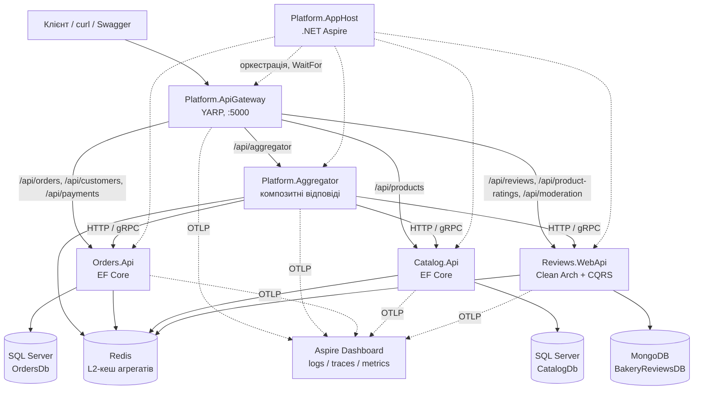
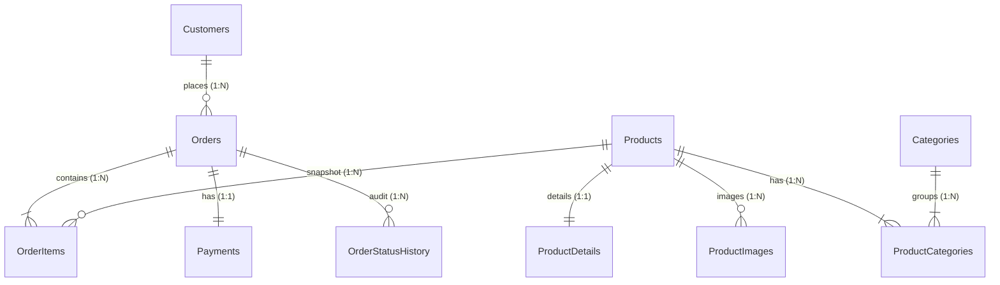

# Craft Bakery Platform — мікросервісна платформа крафтової пекарні

Навчальний семестровий проєкт із дисципліни **«Технології .NET у веб-інженерії»**.
Викладач: **Томка Ю.Я.** | Студент: **Казімір В.І.** (група 443-2).

Платформа складається з трьох бізнес-сервісів (`Catalog`, `Orders`, `Reviews`), API Gateway на YARP,
Aggregator композитних відповідей та спільних `Platform.ServiceDefaults`. Оркестрація — .NET Aspire
(`Platform.AppHost`): SQL Server, MongoDB і Redis у контейнерах з постійними volumes, порядок запуску
через `WaitFor`, трасування та логи в Aspire Dashboard.

---

## 1. Швидкий старт платформи (лабораторна №5)

Потрібні: **.NET SDK 10**, **Docker Desktop** (запущений), PowerShell або bash.

### 1.1. Пароль SQL Server — лише через secret, не в репозиторії

```bash
dotnet user-secrets set "Parameters:sql-password" "YourStrong!Passw0rd" --project Platform.AppHost
```

`Platform.AppHost/Program.cs` читає його як `builder.AddParameter("sql-password", secret: true)` і
передає в `AddSqlServer`. У репозиторії пароля немає: для Docker Compose він лежить у `.env`
(файл у `.gitignore`), поруч лежить шаблон `.env.example`.

### 1.2. Запуск усієї платформи однією командою

```bash
dotnet run --project Platform.AppHost
```

Aspire піднімає контейнери БД, застосовує міграції EF Core при старті сервісів, сіє демо-дані та
запускає сервіси → Aggregator → Gateway. У консолі друкуються адреса **Aspire Dashboard** і login-URL
з токеном — там видно стан ресурсів, логи, traces і metrics.

**API Gateway — єдина точка входу: `http://localhost:5000`.**

| Ресурс | Роль | Порт під Aspire | Порт окремого запуску (`--launch-profile http`) |
|---|---|---|---|
| `gateway` | YARP reverse proxy | **5000 (фіксований)** | 5000 |
| `aggregator` | композитні read-only відповіді | динамічний (див. Dashboard) | 5190 |
| `catalog-api` | товари й категорії, EF Core | динамічний | 5173 |
| `orders-api` | клієнти, замовлення, оплати, EF Core | динамічний | 5172 |
| `reviews-api` | відгуки, рейтинги, модерація, MongoDB | динамічний | 5180 |
| `sql` | SQL Server 2022, контейнер `dotnet-web-sql` | 1433 | 1433 |
| `mongo` | MongoDB 8.3, контейнер `dotnet-web-mongo` | 27017 | 27017 |
| `redis` | Redis 8 (лабораторна №6), контейнер `dotnet-web-redis` | 6379 | 6379 |

Під Aspire сервіси отримують динамічні порти — фактичні URL видно в Dashboard; фіксовані порти з
таблиці діють при окремому запуску проєкту. Gateway завжди на 5000, тому всі приклади нижче — через нього.

### 1.3. Перевірка після старту

```bash
curl http://localhost:5000/health
curl -H "X-Correlation-Id: demo-lab5" http://localhost:5000/api/products/category/1
curl http://localhost:5000/api/aggregator/products/1/overview
```

### 1.4. Альтернатива: інфраструктура одним стеком у Docker Desktop

`docker-compose.yml` піднімає **лише SQL Server і MongoDB** одним стеком `dotnet-web`
(одна кнопка Start/Stop у Docker Desktop):

```bash
cp .env.example .env   # або Copy-Item .env.example .env; задайте сильний MSSQL_SA_PASSWORD
docker compose up -d   # обидва контейнери + мережа dotnet-web + постійні volumes
docker compose ps
docker compose down    # дані у volumes зберігаються
```

Після цього сервіси можна запускати окремо (`dotnet run --project Services/Orders/Orders.Api
--launch-profile http` тощо) — рядки підключення в `appsettings.json` ведуть на `localhost:1433` /
`localhost:27017`. **Не запускайте Compose та Aspire одночасно**: вони використовують однакові імена
контейнерів і volumes (`dotnet-web-sql-data`, `dotnet-web-mongo-data`, `dotnet-web-redis-data`),
тому дані спільні для обох способів запуску й переживають перезапуск.

---

## 2. Архітектура платформи



Та сама діаграма лежить у `docs/overall_architecture.mermaid`.

| Проєкт | Призначення |
|---|---|
| `Platform.AppHost` | Aspire-оркестрація: контейнери SQL/Mongo/Redis з `WithDataVolume`, secret-пароль SQL, бази `CatalogDb`/`OrdersDb`/`BakeryReviewsDB`, `WithReference` + `WaitFor`, фіксований порт Gateway |
| `Platform.ServiceDefaults` | спільні Serilog, OpenTelemetry, health checks, service discovery, CorrelationId middleware і DelegatingHandler |
| `Platform.ApiGateway` | YARP: маршрути й кластери за логічними іменами сервісів, логування маршрутизації |
| `Platform.Aggregator` | паралельні downstream-виклики, композитні DTO, часткові відмови з попередженнями |
| `Services/Catalog/*` | `.Api` / `.Bll` / `.Dal` / `.Domain`: товари, категорії, EF Core Code-First |
| `Services/Orders/*` | `.Api` / `.Bll` / `.Dal` / `.Domain`: клієнти, замовлення, оплати, історія статусів, EF Core |
| `Services/Reviews/*` | `.WebApi` / `.Application` / `.Infrastructure` / `.Domain`: Clean Architecture + CQRS (MediatR) + MongoDB |

**Database-per-Service.** Кожен сервіс має власну базу; імена баз збігаються з іменами рядків
підключення: `ConnectionStrings:CatalogDb`, `ConnectionStrings:OrdersDb`,
`ConnectionStrings:BakeryReviewsDB`. Aspire підставляє їх через `WithReference(database)` як
`ConnectionStrings__CatalogDb` тощо, тому `appsettings.json` містить лише локальний fallback.
Між базами немає фізичних FOREIGN KEY: `OrderItem` зберігає знімок товару (`ProductId`, `ProductName`,
`UnitPrice`), переданий у запиті створення замовлення, тож оформлення замовлення не читає Catalog.

**Порядок запуску.** `WaitFor` задає ланцюг: бази → сервіси → Aggregator → Gateway. Сервіси додатково
чекають Redis, а `EnableRetryOnFailure` у `AddDbContext` переживає холодний старт SQL-контейнера.

### 2.1. Platform.ServiceDefaults

`AddServiceDefaults(...)` підключає:

- **OpenTelemetry**: інструментація ASP.NET Core, HttpClient, SqlClient і MongoDB (`DiagnosticSource`
  через `MongoDbInstrumentation`), власні `ActivitySource` сервісів, `UseOtlpExporter()` за наявності
  `OTEL_EXPORTER_OTLP_ENDPOINT` (Aspire Dashboard); metrics — runtime, ASP.NET Core, HttpClient,
  SqlClient і Meter `Platform.Caching`.
- **Health checks**: `/alive` (live) і `/health` (усі перевірки, зокрема MongoDB у Reviews) через
  `MapDefaultEndpoints()`.
- **Service discovery** + `ConfigureHttpClientDefaults` з `AddServiceDiscovery` і
  `CorrelationIdPropagationHandler`.

`UsePlatformSerilog(serviceName)` налаштовує Serilog: збагачувачі `ServiceName`, `Environment`,
`MachineName`, `ThreadId`, `Enrich.FromLogContext()`, рівні за середовищем (Debug у Development,
Information інакше) з override для шумних категорій, `CompactJsonFormatter` у console sink і
`writeToProviders: true`, щоб логи йшли також в OpenTelemetry.

`UsePlatformDefaults(serviceName)` ставить `CorrelationIdMiddleware` і `UseSerilogRequestLogging`
(метод, шлях, статус, тривалість, `CorrelationId`).

### 2.2. Наскрізний CorrelationId

`CorrelationIdMiddleware` бере `X-Correlation-Id` із запиту або генерує новий, кладе його в
`HttpContext.Items`, у відповідь і в `LogContext` (властивості `CorrelationId`, `CorrelationOrigin`,
`UserId` з `X-User-Id`). Вихідні HTTP-запити отримують той самий заголовок через
`CorrelationIdPropagationHandler` (`DelegatingHandler`, зареєстрований у
`ConfigureHttpClientDefaults`), тому один ідентифікатор видно в логах Gateway, Aggregator і сервісу
та в spans траси.

### 2.3. API Gateway (YARP)

Маршрути й кластери описані в `Platform.ApiGateway/appsettings.json`; адреси кластерів —
`http://<ім'я-ресурсу>` і резолвляться через `AddServiceDiscoveryDestinationResolver()`.

| Префікс Gateway | Кластер | Order |
|---|---|---|
| `/api/aggregator` | `aggregator` | 100 (окремий маршрут на Aggregator) |
| `/api/orders`, `/api/customers`, `/api/payments` | `orders-api` | catch-all |
| `/api/products` | `catalog-api` | catch-all |
| `/api/reviews`, `/api/product-ratings`, `/api/moderation` | `reviews-api` | catch-all |

Порядок middleware: `CorrelationIdMiddleware` → `UseSerilogRequestLogging` → `RouteLoggingMiddleware`
→ `MapReverseProxy()`. `RouteLoggingMiddleware` після кожного запиту логує метод, шлях, `RouteId`,
`ClusterId`, статус і тривалість у мілісекундах разом із `CorrelationId`; unmatched-запити та 4xx/5xx
логуються як Warning/Error.

### 2.4. Aggregator

| Ендпоінт | Що збирає |
|---|---|
| `GET /api/aggregator/orders/{id}/full` | замовлення + клієнт + оплата + відгуки товарів замовлення |
| `GET /api/aggregator/products/{id}/overview` | картка товару + рейтинг + відгуки |
| `GET /api/aggregator/grpc/orders/{id}/full` | те саме через gRPC-клієнти (лабораторна №6) |

Незалежні downstream-запити виконуються паралельно (`Task.WhenAll`). Кожен типізований `HttpClient`
має явний `Timeout = 5 с` (`Platform.Aggregator/Program.cs`), тому недоступний сервіс не тягне за собою
стандартні 100 с очікування. Якщо один із сервісів недоступний, Aggregator повертає **200 із частковим
результатом і масивом `warnings`**, а не падає; критична відмова (замовлення не знайдено / Orders
лежить) дає 404/503. Бізнес-операції та downstream-виклики мають власні spans
(`AggregatorActivitySources`, `OrdersActivitySources`, `CatalogActivitySources`,
`ReviewsActivitySources`).

---

## 3. Приклади запитів через Gateway (`http://localhost:5000`)

```bash
# health Gateway
curl http://localhost:5000/health

# CorrelationId проходить крізь Gateway у сервіс і повертається у відповіді
curl -i -H "X-Correlation-Id: demo-lab5" http://localhost:5000/api/products/category/1

# клієнти та замовлення
curl http://localhost:5000/api/customers
curl -X POST http://localhost:5000/api/customers -H "Content-Type: application/json" \
  -d '{"firstName":"Оксана","lastName":"Бондар","email":"oksana.bondar@example.com","phoneNumber":"0981122334","gender":"F","age":26}'
curl -X POST http://localhost:5000/api/orders -H "Content-Type: application/json" \
  -d '{"customerId":1,"items":[{"productId":1,"productName":"Круасан масляний","unitPrice":45.0,"quantity":2}],"notes":"еко-пакет"}'
curl http://localhost:5000/api/orders/1
curl http://localhost:5000/api/orders/1/history
curl -X POST http://localhost:5000/api/payments -H "Content-Type: application/json" \
  -d '{"orderId":1,"paymentMethod":"ApplePay","amount":90.00}'

# відгуки й модерація
curl "http://localhost:5000/api/reviews?limit=2"
curl http://localhost:5000/api/product-ratings/1
curl "http://localhost:5000/api/moderation/logs?limit=5"

# композитні відповіді Aggregator
curl http://localhost:5000/api/aggregator/products/1/overview
curl http://localhost:5000/api/aggregator/orders/1/full
curl http://localhost:5000/api/aggregator/grpc/orders/1/full   # лаба №6: поки що 500, див. §4
```

Swagger кожного сервісу доступний через його власний порт (напр. `http://localhost:5173/swagger`
при окремому запуску); Gateway проксіює лише API-маршрути.

### 3.1. Перевірка часткової відмови (failure drill)

1. Зупиніть `reviews-api`: у Aspire Dashboard кнопка **Stop** на ресурсі, або завершіть процес
   (`taskkill /PID <pid> /T /F` для `dotnet run … Reviews.WebApi.csproj`).
2. Візьміть товар, який ще не агрегувався (кеш агрегатів живе 45 с і може віддати попередню повну
   відповідь): `curl http://localhost:5000/api/aggregator/products/3/overview`.
3. Очікуваний результат — **200** приблизно за 5 с, картка товару заповнена, `reviews: []`,
   рейтинг відсутній, три попередження:

   ```json
   {
     "productId": 3,
     "product": { "productId": 3, "name": "Чізкейк Сан-Себастьян", "categories": ["Хліб", "Випічка"] },
     "reviews": [],
     "warnings": [
       "«рейтингу товару 3» недоступний: таймаут вичерпано",
       "«схвалених відгуків товару 3» недоступний: таймаут вичерпано",
       "«найкращих відгуків товару 3» недоступний: таймаут вичерпано"
     ],
     "downstreamCalls": 3,
     "assemblyDurationMilliseconds": 5104.25
   }
   ```

4. Запустіть `reviews-api` знову (Dashboard **Start** або перезапуск AppHost) — наступний запит
   повертає повну відповідь без попереджень.

Те саме для `catalog-api`: огляд товару деградує до даних Reviews/Orders із попередженням.
Якщо товар не існує, відповідь — **404 ProblemDetails** з `correlationId` і `traceId` (перевірено:
`/api/aggregator/products/4/overview` → 404 «Товар не знайдено» за 0.14 с).

### 3.2. Бізнес-правила попередніх лабораторій (ті самі ендпоінти через Gateway)

```bash
# пагінація + фільтр + сортування замовлень клієнта
curl "http://localhost:5000/api/orders/customer/1?page=1&pageSize=5&sortBy=totalAmount&desc=false"
# недозволений перехід статусу → 409; повторна оплата → 409
curl -X PATCH http://localhost:5000/api/orders/1/status -H "Content-Type: application/json" -d '{"newStatus":"Baking"}'
# один товар у двох рядках → 400 ValidationProblemDetails (правило лише у FluentValidation)
curl -X POST http://localhost:5000/api/orders -H "Content-Type: application/json" \
  -d '{"customerId":1,"items":[{"productId":1,"productName":"Круасан","unitPrice":45.0,"quantity":2},{"productId":1,"productName":"Круасан","unitPrice":45.0,"quantity":3}]}'
# M:N категорії з фільтром за AddedAt
curl "http://localhost:5000/api/products/category/1?notEarlierThan=2030-01-01T00:00:00Z"
# ETag / If-Match: оновлення зі старим ETag → 409
curl -i http://localhost:5000/api/reviews/<id>
curl -X PUT http://localhost:5000/api/reviews/<id> -H 'If-Match: W/"1"' -H "Content-Type: application/json" \
  -d '{"comment":"Оновлений текст","taste":5,"freshness":4,"aroma":5,"tags":["хрусткий"]}'
# модерація в транзакції MongoDB
curl -X POST http://localhost:5000/api/moderation/reviews/<id> -H "Content-Type: application/json" \
  -d '{"action":"Approved","moderator":"admin_olya","notes":"Правила не порушено"}'
```

---

## 4. Лабораторна №6: gRPC та дворівневе кешування

Redis додається в AppHost через `AddRedis("redis").WithDataVolume("dotnet-web-redis-data")`; сервіси й
Aggregator отримують його через `WithReference(redis)` + `AddRedisDistributedCache("redis")`.

- **L1** — `IMemoryCache` у `Caching/` кожного сервісу (`SizeLimit = 10_000`, sliding/absolute
  expiration, cache-aside). **L2** — Redis через `IDistributedCache`; DTO серіалізуються
  `System.Text.Json`, ключі з префіксами сервісів (`CacheKeys`), після запису пов'язані ключі
  інвалідуються синхронно.
- Aggregator кешує повні відповіді в Redis на 45 с і **не кешує** часткові результати з попередженнями.
- Контракти: `Protos/catalog.proto`, `Protos/orders.proto`, `Protos/reviews.proto` у кожному сервісі;
  сервери — `Grpc/*GrpcService.cs` (адаптери над BLL/`ISender`, `InvalidArgument`/`NotFound` замість
  `Internal`), реєстрація `AddGrpc` + `MapGrpcService`. Клієнти Aggregator — типізовані `AddGrpcClient`
  з service discovery і `GrpcClientLoggingInterceptor`; незалежні виклики паралельні, `Unavailable` /
  `DeadlineExceeded` перетворюються на частковий результат або 503.
- Метрики кешу: Meter `Platform.Caching`, лічильники `cache.hits` / `cache.misses` (`CacheMetrics`).
- В Aggregator уже стоїть `AppContext.SetSwitch("System.Net.Http.SocketsHttpHandler.Http2UnencryptedSupport", true)`.

**Відомий gap лабораторної №6 (ще не закрито).** `GET /api/aggregator/grpc/orders/{id}/full`
зараз віддає **500**. Дві причини, обидві підтверджені логами процесів:

1. `GrpcChannel.ForAddress` не резолвить схему `https+http://` — у
   `Microsoft.Extensions.ServiceDiscovery` 10.7.0 немає gRPC-інтеграції
   (`InvalidOperationException: No address resolver configured for the scheme 'https+http'`).
2. Kestrel без TLS не вмикає HTTP/2 на ендпоінті з `Http1AndHttp2`:
   «HTTP/2 is not enabled … Connections to this endpoint will use HTTP/1.1», тобто h2c фактично не працює.

План виправлення: окремий HTTP/2-only plaintext ендпоінт для gRPC у кожному сервісі та адресація
gRPC-клієнтів через `IHttpClientFactory` із service discovery замість `https+http`.
REST-агрегати (§2.4) працюють і перевірені на живій платформі.

---

## 5. Сервіси та дані

### 5.1. Catalog (EF Core)

Шари `.Domain` → `.Dal` → `.Bll` → `.Api`. `CatalogDbContext` + `IEntityTypeConfiguration<T>`,
`GenericRepository<T>` зі специфікаціями (`WithSpecification` віддає `IQueryable<T>`), `UnitOfWork`,
AutoMapper, FluentValidation у BLL. Ендпоінти: `GET /api/products/{id}` (картка товару),
`GET /api/products/category/{categoryId}?notEarlierThan=` (M:N `ProductCategory` з фільтром `AddedAt`).

### 5.2. Orders (EF Core)

Ті самі шари; сутності `Customers`, `Orders`, `OrderItems`, `Payments`, `OrderStatusHistories`.
`OrderItem` — знімок товару, без навігації в Catalog. Ендпоінти: `/api/customers` (CRUD),
`/api/orders` (CRUD + `customer/{id}` пагінація + `{id}/history` explicit loading + `{id}/status`
state machine + `{id}/cancel`), `/api/payments` (`POST`, `GET order/{orderId}`).

### 5.3. Reviews (Clean Architecture + CQRS + MongoDB)

| Проєкт | Що покладено |
|---|---|
| `Reviews.Domain` | сутності `Review`/`ProductRating`/`ModerationLog`, незмінні VO, доменні винятки, інтерфейси репозиторіїв |
| `Reviews.Application` | команди/queries через MediatR, конвеєр біхавіорів `ExceptionHandling → Validation → Logging → Caching → Performance`, валідатори, `AddApplication()` |
| `Reviews.Infrastructure` | `MongoDbContext`, `BsonClassMap` + конвенції, репозиторії, транзакції, індекси, ідемпотентний сід, health check |
| `Reviews.WebApi` | тонкі контролери (`ISender.Send`), ETag/If-Match, ProblemDetails, Swagger |

Колекції `reviews`, `product_ratings`, `moderation_logs`; денормалізований `averageRating`,
cursor-пагінація на боці MongoDB, optimistic concurrency через `version` → ETag `W/"n"`,
модерація й видалення — в транзакції репліка-сету.

### 5.4. ERD



`OrdersDb`: `Customers`, `Orders`, `OrderItems` (знімок `ProductName`/`UnitPrice`), `Payments`,
`OrderStatusHistory`. `CatalogDb`: `Products`, `Categories`, `ProductCategories` (`AddedAt`),
`ProductDetails`, `ProductImages`. `BakeryReviewsDB`: документні колекції з §5.3.

### 5.5. Міграції та сід

```bash
dotnet ef migrations add <Name> --project Services/Catalog/Catalog.Dal --startup-project Services/Catalog/Catalog.Api
dotnet ef migrations add <Name> --project Services/Orders/Orders.Dal --startup-project Services/Orders/Orders.Api
dotnet ef database update --project Services/Orders/Orders.Dal --startup-project Services/Orders/Orders.Api
```

Міграції застосовуються автоматично при старті (`MigrateAsync`), у Development далі виконується
ідемпотентний сід. Якщо в базі лишилася схема лабораторних 1–2 без `__EFMigrationsHistory`, сервіс
кидає зрозуміле повідомлення з командою `dotnet ef database drop -f ...` (захист у `Program.cs`).

### 5.6. Скрипти лабораторної №1

```text
db/
├── p1/    # Orders: schema.sql · procedures.sql · seed.sql
├── p2/    # Catalog: schema.sql · seed.sql
└── p3/    # MongoDB: collections.js · seed.js
```

MongoDB для транзакцій потрібен як одно-вузловий репліка-сет `rs0` (`mongod --replSet rs0` +
`rs.initiate()`); від лабораторної №4 індекси й сід виконує сам сервіс (`MongoIndexInitializer`,
`MongoDataSeeder`), тому ручні скрипти не обов'язкові.

### 5.7. Політика дублювання даних між базами (Data Duplication Policy)

Між `CatalogDb`, `OrdersDb` і `BakeryReviewsDB` **немає фізичних FOREIGN KEY**: усі міжсервісні
посилання — числові `Id`, кожна база належить рівно одному сервісу (Database-per-Service).

| Дані | База-власник (Master) | Де дублюється (Replica) | Мета дублювання | Механізм узгодженості |
|---|---|---|---|---|
| `UnitPrice` | `CatalogDb.Products` | `OrdersDb.OrderItems` | Сума чеку не змінюється, коли каталог переоцінює товар | **Знімок:** `Order.AddItem` копіює ціну в момент створення замовлення |
| `ProductName` | `CatalogDb.Products` | `OrdersDb.OrderItems` | Чек і список позицій формуються без звернення до Catalog | **Знімок:** `Order.AddItem` копіює назву в момент покупки |
| `ProductName` | `CatalogDb.Products` | `BakeryReviewsDB.reviews` | Видача списку відгуків без міжсервісного join | **Знімок:** `Review.Create`; перейменування товару не переноситься на вже написані відгуки |
| `CustomerName` | `OrdersDb.Customers` | `BakeryReviewsDB.reviews` | Показ автора відгуку без звернення до бази клієнтів | **Знімок:** `Review.Create` |
| `averageRating` | `BakeryReviewsDB.reviews` | `BakeryReviewsDB.product_ratings` | Швидка видача рейтингу товару без агрегації щоразу | **Перерахунок:** `ProductRatingRepository.RecalculateAsync` у транзакції модерації/видалення |

Актуальні дані каталогу в замовлення не копіюються взагалі — їх komponує Aggregator під час
читання (`GET /api/aggregator/products/{id}/overview`, `GET /api/aggregator/orders/{id}/full`).
Подієва узгодженість (`ProductCatalogUpdatedEvent`, `ProductRenamedEvent`,
`CustomerProfileUpdatedEvent`) у проєкті **не реалізована**: історичні копії є навмисними
знімками, а не репліками, які потрібно синхронізувати. Локального довідника `Products`
у `OrdersDb` теж немає — сервіс замовлень не зберігає каталог.

Опис контекстів і початкова редакція політики — у `docs/contexts_description.md`.

---

## 6. Відповідність критеріям лабораторної №5

| Критерій | Де в коді |
|---|---|
| Контейнери SQL/Mongo з постійним сховищем, пароль-секрет, імена баз = рядки підключення | `Platform.AppHost/Program.cs` (`AddParameter(secret: true)`, `WithDataVolume`, `AddDatabase`), `docker-compose.yml`, `appsettings.json` сервісів |
| `WithReference` + `WaitFor`, порядок БД → сервіси → Aggregator → Gateway, фіксований порт Gateway | `Platform.AppHost/Program.cs` |
| `AddServiceDefaults` + `MapDefaultEndpoints`, рядки з конфігурації, `/api/{domain}` | `Program.cs` трьох сервісів, контролери з `[Route("api/...")]` |
| Бізнес-логи та власні spans | `*/Diagnostics/*ActivitySources.cs`, `Log.Information` з `OrderId`/`Status` у сервісах і Aggregator |
| Serilog: збагачувачі, `FromLogContext`, рівні за середовищем, `CompactJsonFormatter`, `writeToProviders` | `Platform.ServiceDefaults/Extensions.cs` (`UsePlatformSerilog`) |
| CorrelationId: middleware + вихідний DelegatingHandler | `Platform.ServiceDefaults/CorrelationIdMiddleware.cs`, `CorrelationIdPropagationHandler.cs`, реєстрація в `ConfigureHttpClientDefaults` |
| OTel: HTTP, SQL, MongoDB + OTLP | `Platform.ServiceDefaults/Extensions.cs` (`ConfigureOpenTelemetry`), `MongoDbInstrumentation.cs` |
| YARP маршрути/кластери з логічними іменами, service discovery resolver | `Platform.ApiGateway/appsettings.json`, `Program.cs` |
| CorrelationId перед `MapReverseProxy`, логи метод/шлях/маршрут/статус/тривалість | `Platform.ApiGateway/Program.cs`, `RouteLoggingMiddleware.cs` |
| Aggregator: паралельні виклики, часткові відмови, попередження | `Platform.Aggregator/Services/*`, `Clients/DownstreamClient.cs`, `Controllers/AggregationController.cs` |
| Таймаут downstream-викликів 5 с → деградація за 5 с, а не 100 с | `Platform.Aggregator/Program.cs` (`client.Timeout`) |
| Політика дублювання даних між базами, Database-per-Service без фізичних FK | README §5.7, `Order.AddItem`, `Review.Create`, `docs/contexts_description.md` |
| README з інструкцією запуску | цей файл, §1 і §3 |

**Перевірено на живій платформі** (Aspire + Docker, gateway `:5000`):

- `/health` → 200; картка `/api/products/1` → `productId: 1`, `categories: ["Випічка","Десерти"]`.
- Наскрізний `X-Correlation-Id: lab6-e2e` видно в логах усіх п'яти процесів: Gateway, Aggregator,
  Catalog.Api, Orders.Api, Reviews.WebApi.
- Бізнес-логи повертаються з `SourceContext` сервісу: `OrderService` («Створено замовлення…»),
  `PaymentService` («Оплата … проведена…»), `CreateReviewCommandHandler` («Відгук … створено…»),
  `ProductService` («Каталог: товар …»).
- Записи крізь Gateway: `POST /api/orders` → 201 (total 90.00), `POST /api/payments` → 201,
  `POST /api/reviews` → 201; повторний відгук того самого клієнта на той самий товар → 400.
- Failure drill: `reviews-api` зупинено → огляд товару **200 + 3 warnings за 5.1 с** (§3.1).
- Дані переживають перезапуск AppHost: замовлення 2 і 3 у SQL, відгук у MongoDB лишаються на місці
  (`WithDataVolume`).
- `dotnet build Platform.slnx` → 0 помилок, 7 відомих warning (NU1903/NU1904, ASPIRE010).

---

## 7. Додаток: рішення лабораторних №2–4

- **Specification pattern**: `CustomerOrdersSpecification` + `SpecificationEvaluator`;
  `GenericRepository.WithSpecification(spec, applyPaging)` віддає `IQueryable<T>` для власного LINQ.
- **Пагінація**: `page`, `pageSize` (1…100), `status`, `sortBy` (`orderDate|totalAmount|status`),
  `desc`; відповідь `items/page/pageSize/totalCount/totalPages/hasNext/hasPrevious`.
- **Валідація у два рівні**: DataAnnotations на DTO (ModelState) + FluentValidation у BLL через
  `IValidator<T>` у конструкторі сервісу і `ValidateAndThrowAsync` (без auto-validation); помилки —
  `400 ValidationProblemDetails`.
- **Єдина обробка помилок**: `GlobalExceptionHandlerMiddleware` → `NotFoundException` 404,
  `BusinessConflictException`/`DbUpdateConcurrencyException` 409, валідація 400, інші 500.
- **Reviews**: мапінг без атрибутів у домені, інкапсульовані VO, денормалізований `averageRating`,
  cursor-пагінація `{sortValue}_{hexId24}`, ETag/If-Match, транзакції модерації, `CachingBehavior`
  для `ICacheableQuery`.
- **Чистота збірки**: `dotnet build Platform.slnx` — 0 помилок; лишаються лише відомі NuGet-застереження
  щодо Aspire 13.6.4 (NU1903/NU1904) та інформаційне ASPIRE010; `<NoWarn` у проєктах немає.

---

## 8. Статус лабораторних

| Лаба | Тема | Стан |
|---|---|---|
| №1 | Проєктування БД (3 контексти, SQL + MongoDB) | виконано |
| №2 | Тришарова архітектура на ADO.NET/Dapper | виконано (`lab-02`) |
| №3 | EF Core Code-First, специфікації, валідація | виконано (`lab-03`, доопрацювання в `lab-04`) |
| №4 | Clean Architecture + CQRS + MongoDB (Reviews) | виконано (`lab-04`) |
| №5 | Мікросервісна платформа: AppHost, ServiceDefaults, Gateway, Aggregator | здано (`lab-05`) |
| №6 | gRPC + дворівневе кешування Memory/Redis | у роботі (`lab-06`) |

## 9. Корисні команди

```bash
dotnet build Platform.slnx
dotnet run --project Platform.AppHost
dotnet user-secrets list --project Platform.AppHost
docker compose up -d && docker compose ps
docker volume ls | grep dotnet-web
```