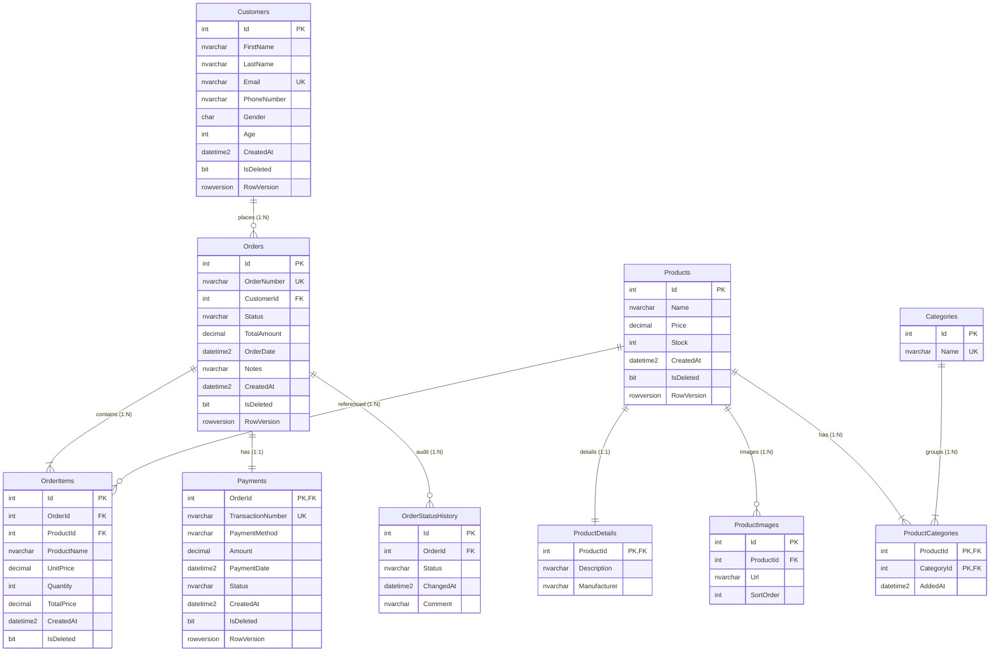
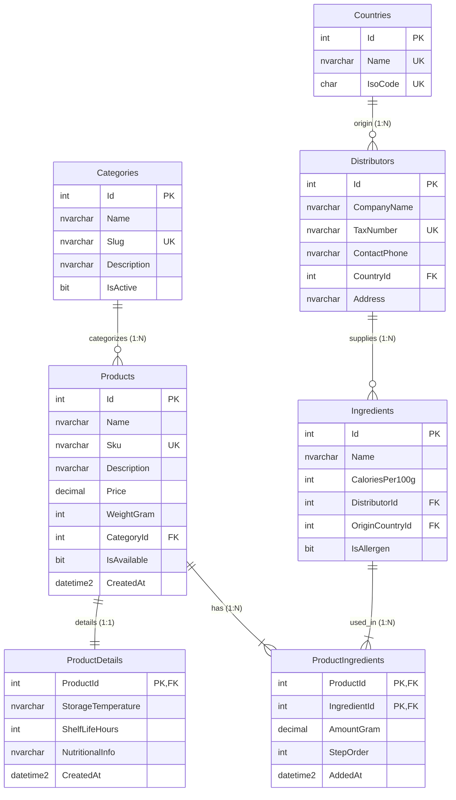
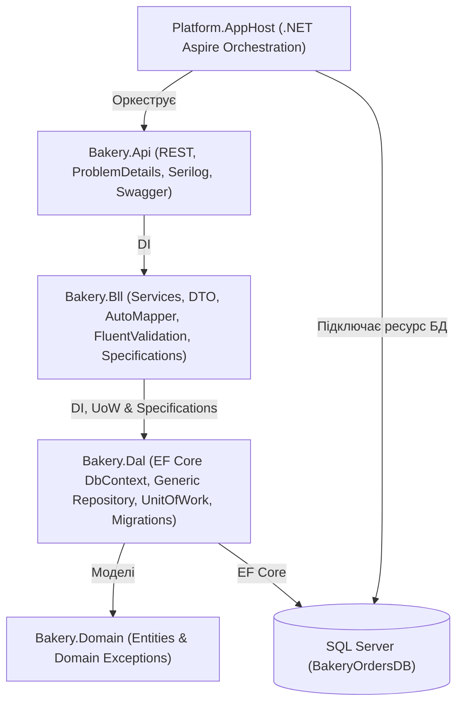

# Craft Bakery Platform — Платформа крафтової пекарні

Навчальний семестровий проєкт із дисципліни **«Технології .NET у веб-інженерії»**.
Викладач: **Томка Ю.Я.** | Студент: **Казімір В.І.** (група 443-2).

---

## 1. Опис предметної області та архітектури

Проєкт являє собою розподілену систему для крафтової пекарні **«Craft Bakery»**, що забезпечує автоматизацію прийому онлайн-замовлень свіжої випічки, управління асортиментом та технологічними картами (рецептурою), а також збір і модерацію відгуків покупців.

Система спроєктована на базі патерну **Database-per-Service** і розділена на три незалежні контексти:
1. **Orders Context (Замовлення та клієнти):** реляційна БД `BakeryOrdersDB` (SQL Server, доступ через **EF Core 10, Code-First**).
   - **Сутності:** `Customers`, `Orders`, `OrderItems`, `Payments`, `OrderStatusHistory`, `Products`, а також довідкові `Categories`, `ProductCategories`, `ProductDetails` (1:1), `ProductImages`.
2. **Catalog Context (Каталог та рецептура):** реляційна БД `BakeryCatalogDB` (SQL Server).
   - **Сутності:** `Countries`, `Categories`, `Products`, `ProductDetails` (1:1), `Distributors`, `Ingredients`, `ProductIngredients` (M:N).
3. **Reviews Context (Відгуки покупців):** документоорієнтована NoSQL БД `BakeryReviewsDB` (MongoDB).
   - **Колекції:** `reviews`, `product_ratings`, `moderation_logs`.

> [!IMPORTANT]
> Між базами даних **відсутні фізичні зв'язки FOREIGN KEY**. Усі міжсервісні посилання здійснюються за числовими ідентифікаторами (`Id`), що гарантує повну незалежність розгортання та автономність кожного мікросервісу.

> [!NOTE]
> У межах лабораторної №3 доменну модель розширено довідковими сутностями каталогу (`Category`, `ProductCategory`, `ProductDetail`, `ProductImage`) — щоб продемонструвати зв'язки 1:1 та M:N у Fluent API. Фізично вони зберігаються в `BakeryOrdersDB`; винесення в окремий Catalog-сервіс — окремий крок курсу.

---

## 2. Політика дублювання даних між базами (Data Duplication Policy)

| Поле / Дані | База-власник (Master) | Де дублюється (Replica) | Мета дублювання | Механізм підтримки узгодженості |
|---|---|---|---|---|
| `UnitPrice` (Ціна товару) | `BakeryCatalogDB.Products` | `BakeryOrdersDB.OrderItems` | Фіксація суми покупки: зміна ціни в каталозі не впливає на старі чеки | **Знімок (Snapshot):** копіюється в момент створення замовлення |
| `ProductName` (Назва товару) | `BakeryCatalogDB.Products` | `BakeryOrdersDB.OrderItems` | Автономність друку чеків та звітів без мережевих запитів до каталогу | **Знімок (Snapshot):** копіюється в момент покупки |
| `Products.Name, Price` | `BakeryCatalogDB.Products` | `BakeryOrdersDB.Products` | Локальна копія довідника товарів для швидкого оформлення кошика та перевірки наявності | **Подієва узгодженість (Eventual Consistency):** подія `ProductCatalogUpdatedEvent` |
| `ProductName` (Назва товару) | `BakeryCatalogDB.Products` | `BakeryReviewsDB.reviews` | Швидка видача списку відгуків клієнту без міжсервісних Join | **Подієва узгодженість (Eventual Consistency):** подія `ProductRenamedEvent` |
| `CustomerName` (Ім'я клієнта) | `BakeryOrdersDB.Customers` | `BakeryReviewsDB.reviews` | Відображення автора відгуку без звернення до бази клієнтів | **Подієва узгодженість (Eventual Consistency):** подія `CustomerProfileUpdatedEvent` |

---

## 3. Діаграми сутностей (ERD)

### 3.1. Діаграма Проєкту №1 (Orders Context — BakeryOrdersDB)

Зв'язки: 1:1 (`Orders` $\leftrightarrow$ `Payments`, `Products` $\leftrightarrow$ `ProductDetails`), 1:N (`Customers` $\rightarrow$ `Orders`, `Orders` $\rightarrow$ `OrderItems`, `Orders` $\rightarrow$ `OrderStatusHistory`), M:N (`Orders` $\leftrightarrow$ `Products` через `OrderItems`; `Products` $\leftrightarrow$ `Categories` через `ProductCategories`).



### 3.2. Діаграма Проєкту №2 (Catalog Context — BakeryCatalogDB)
Зв'язки: 1:1 (`Products` $\leftrightarrow$ `ProductDetails`), 1:N (`Categories` $\rightarrow$ `Products`, `Countries` $\rightarrow$ `Distributors`), M:N (`Products` $\leftrightarrow$ `Ingredients` через `ProductIngredients` з власним полем `AmountGram`).



---

## 4. Розгортання баз даних

### 4.1. SQL-скрипти (лабораторна №1)

Скрипти згруповані у каталозі `db/`:
```text
db/
├── p1/    # Проєкт №1 (Orders): schema.sql · procedures.sql · seed.sql
├── p2/    # Проєкт №2 (Catalog): schema.sql · seed.sql
└── p3/    # Проєкт №3 (MongoDB): collections.js · seed.js
```

```sql
:r db/p1/schema.sql        -- таблиці, зв'язки, індекси
:r db/p1/procedures.sql    -- збережувані процедури (State Machine статусів)
:r db/p1/seed.sql          -- ідемпотентний сід
:r db/p2/schema.sql
:r db/p2/seed.sql
```

### 4.2. MongoDB (лабораторна №1)

```bash
mongosh BakeryReviewsDB db/p3/collections.js
mongosh BakeryReviewsDB db/p3/seed.js
```

### 4.3. Міграції EF Core (лабораторна №3)

Схема Orders-сервісу тепер керується **EF Core Code-First**: 10 конфігурацій `IEntityTypeConfiguration<T>`
(Fluent API: PK/FK, check-constraints, unique-індекси, `rowversion`, 1:1 та M:N) і одна міграція `InitialCreate`.

```bash
# створити нову міграцію
dotnet ef migrations add <Name> \
  --project Services/Bakery/Bakery.Dal \
  --startup-project Services/Bakery/Bakery.Api

# застосувати до БД (також виконується автоматично при старті застосунку)
dotnet ef database update \
  --project Services/Bakery/Bakery.Dal \
  --startup-project Services/Bakery/Bakery.Api

# згенерувати SQL-скрипт міграції
dotnet ef migrations script \
  --project Services/Bakery/Bakery.Dal \
  --startup-project Services/Bakery/Bakery.Api
```

Міграція застосовується у `Program.cs` через `MigrateAsync()`; у Development після неї виконується
ідемпотентний сід (`DbInitializer`): 3 товари та 2 клієнти, категорії — через `InsertData` у міграції.

> [!IMPORTANT]
> Якщо `BakeryOrdersDB` уже створена скриптами лаби 1/2, у ній немає `__EFMigrationsHistory`,
> і `MigrateAsync()` завершиться помилкою `There is already an object named 'Customers'`.
> Застосунок перевіряє це на старті та кидає зрозуміле повідомлення. Перед першим запуском видаліть базу:
>
> ```bash
> dotnet ef database drop -f \
>   --project Services/Bakery/Bakery.Dal \
>   --startup-project Services/Bakery/Bakery.Api
> ```
>
> Дані лаби 1/2 відтворюються скриптами `db/p1`–`db/p2` та сідом EF Core.

---

## 5. Архітектура сервісу `Bakery` (лабораторні №2–3)

- **`Bakery.Domain`**: доменні моделі з інкапсуляцією (`Customer`, `Order`, `OrderItem`, `Payment`, `Product`,
  `OrderStatusHistory`, `Category`, `ProductCategory`, `ProductDetail`, `ProductImage`) та доменні винятки
  (`NotFoundException`, `BusinessConflictException`, `ValidationException`, `DomainValidationException`).
  Жодних залежностей від EF Core чи ASP.NET.
- **`Bakery.Dal`** (Data Access Layer):
  - `BakeryDbContext` + `ApplyConfigurationsFromAssembly` (Fluent API) та `Migrations/`.
  - `GenericRepository<T>` — асинхронний CRUD (`GetByIdAsync`, `GetAllAsync`, `AddAsync`, `Update`, `Delete`,
    `CountAsync`) і читання за специфікацією (`ListAsync(ISpecification<T>)`, `CountAsync(ISpecification<T>)`).
  - Спеціалізовані репозиторії: `CustomerRepository`, `OrderRepository`, `PaymentRepository`, `ProductRepository`.
  - `OrderRepository.GetWithDetailsAsync` — **eager loading** (`Include`/`ThenInclude`);
    `GetWithExplicitPaymentAsync` — **explicit loading** (`Entry(...).Reference(...).LoadAsync`);
    фільтрація/сортування замовлень — **LINQ to Entities**.
  - `UnitOfWork` (єдина точка `SaveChangesAsync` і транзакцій) та `SpecificationEvaluator`.
- **`Bakery.Bll`** (Business Logic Layer): `CustomerService`, `OrderService`, `PaymentService`; DTO
  (`CreateCustomerRequest`, `CreateOrderRequest`, `OrderQuery`, `PagedResponse<T>` тощо); AutoMapper-профіль;
  валідатори FluentValidation; `CustomerOrdersSpecification`.
- **`Bakery.Api`** (Presentation): тонкі асинхронні контролери, коректні коди відповідей, Swagger,
  `GlobalExceptionHandlerMiddleware` (ProblemDetails), `CorrelationIdMiddleware`, Serilog.
- **`Platform.AppHost`**: .NET Aspire оркестратор (API + SQL Server).



### 5.1. Specification pattern

Складна логіка вибірки винесена з репозиторію в окремий клас `CustomerOrdersSpecification`
(критерій, `Include`, сортування, `Skip`/`Take`). Репозиторій приймає специфікацію як параметр,
`SpecificationEvaluator` транслює її в LINQ-вираз для EF Core:

```csharp
var specification = new CustomerOrdersSpecification(customerId, query.Status, page, pageSize, query.SortBy, query.Desc);
var entities = await uow.Orders.ListAsync(specification, ct);
var total = await uow.Orders.CountAsync(specification, ct);
```

Специфікація залежить лише від `System.Linq.Expressions`, тому її можна тестувати окремо від EF.

### 5.2. Пагінація, фільтрація, сортування

`GET /api/v1/orders/customer/{customerId}` приймає:

| Параметр | Значення за замовчуванням | Опис |
|---|---|---|
| `page` | `1` | номер сторінки (мінімум 1) |
| `pageSize` | `10` | розмір сторінки (1…100) |
| `status` | — | фільтр за статусом замовлення |
| `sortBy` | `orderDate` | `orderDate` \| `totalAmount` \| `status` |
| `desc` | `true` | напрямок сортування |

Відповідь: `items`, `page`, `pageSize`, `totalCount`, `totalPages`, `hasNext`, `hasPrevious`.

### 5.3. Валідація

Два рівні: **DataAnnotations** на DTO (`[Required]`, `[Range]`, `[EmailAddress]`, `[RegularExpression]`) та
**FluentValidation** (`CreateCustomerRequestValidator`, `CreateOrderRequestValidator`,
`ProcessPaymentRequestValidator`). Помилки повертаються як `400` + `ValidationProblemDetails`
з переліком полів у `errors`.

### 5.4. Централізована обробка помилок

`GlobalExceptionHandlerMiddleware` перехоплює всі невиловлені винятки та повертає `ProblemDetails`:

| Виняток | HTTP |
|---|---|
| `NotFoundException` | 404 |
| `BusinessConflictException` | 409 |
| `ValidationException`, `DomainValidationException`, `ArgumentException` | 400 |
| `DbUpdateException` / `DbUpdateConcurrencyException` | 409 |
| інші | 500 (деталі — лише в Development) |

### 5.5. Логування (Serilog)

Serilog налаштований у `Program.cs` та `appsettings.json` (рівні, console sink, output template).
Кожен запит логується через `UseSerilogRequestLogging` (метод, шлях, статус, тривалість).
`CorrelationIdMiddleware` додає до всіх логів `CorrelationId` (з заголовка `X-Correlation-Id` або
`TraceIdentifier`) та `UserId` (з `X-User-Id`, якщо переданий), а також повертає `X-Correlation-Id`
у відповіді.

---

## 6. Запуск

### Через .NET Aspire
```bash
dotnet run --project Platform.AppHost/Platform.AppHost.csproj
```
Aspire піднімає SQL Server у контейнері та API; адреса Aspire Dashboard і порти сервісів
друкуються в консолі запуску.

### API окремо
```bash
dotnet run --project Services/Bakery/Bakery.Api/Bakery.Api.csproj
```
- HTTP: `http://localhost:5172`
- HTTPS: `https://localhost:7236`
- Swagger UI: `http://localhost:5172/swagger`

---

## 7. Приклади запитів

1. **Створення клієнта (201 Created):**
```bash
curl -X POST http://localhost:5172/api/v1/customers \
  -H "Content-Type: application/json" \
  -d '{
    "firstName": "Оксана",
    "lastName": "Бондар",
    "email": "oksana.bondar@example.com",
    "phoneNumber": "0981122334",
    "gender": "F",
    "age": 26
  }'
```

2. **Список клієнтів (200 OK):**
```bash
curl http://localhost:5172/api/v1/customers
```

3. **Оформлення замовлення (201 Created, знімок ціни з БД):**
```bash
curl -X POST http://localhost:5172/api/v1/orders \
  -H "Content-Type: application/json" \
  -d '{
    "customerId": 1,
    "items": [
      { "productId": 1, "quantity": 2 },
      { "productId": 3, "quantity": 1 }
    ],
    "notes": "Прохання упакувати в еко-пакет"
  }'
```

4. **Замовлення з деталями (eager loading):**
```bash
curl http://localhost:5172/api/v1/orders/1
```

5. **Пагінація + фільтр + сортування:**
```bash
curl "http://localhost:5172/api/v1/orders/customer/1?page=1&pageSize=5&sortBy=totalAmount&desc=false"
```

6. **Оплата замовлення (201 Created; сума має дорівнювати `totalAmount`):**
```bash
curl -X POST http://localhost:5172/api/v1/payments \
  -H "Content-Type: application/json" \
  -d '{ "orderId": 1, "paymentMethod": "ApplePay", "amount": 280.00 }'
```
Повторна оплата того ж замовлення → `409 Conflict`.

7. **Зміна статусу (State Machine; недозволений перехід → 409):**
```bash
curl -X PATCH http://localhost:5172/api/v1/orders/1/status \
  -H "Content-Type: application/json" \
  -d '{ "newStatus": "Baking" }'
```

8. **Перевірка ProblemDetails (404):**
```bash
curl http://localhost:5172/api/v1/orders/99999
```

9. **Передача CorrelationId у логи:**
```bash
curl -H "X-Correlation-Id: demo-123" http://localhost:5172/api/v1/customers
```

---

## 8. Статус лабораторних

| Лаба | Тема | Стан |
|---|---|---|
| №1 | Проєктування БД (3 контексти, SQL + MongoDB) | виконано |
| №2 | Тришарова архітектура на ADO.NET/Dapper | виконано (гілка `lab-02`) |
| №3 | Тришарова архітектура на EF Core, Code-First, специфікації | поточна гілка `lab-03` |

### Корисні команди

```bash
dotnet build Platform.slnx
dotnet ef migrations list --project Services/Bakery/Bakery.Dal --startup-project Services/Bakery/Bakery.Api
```
