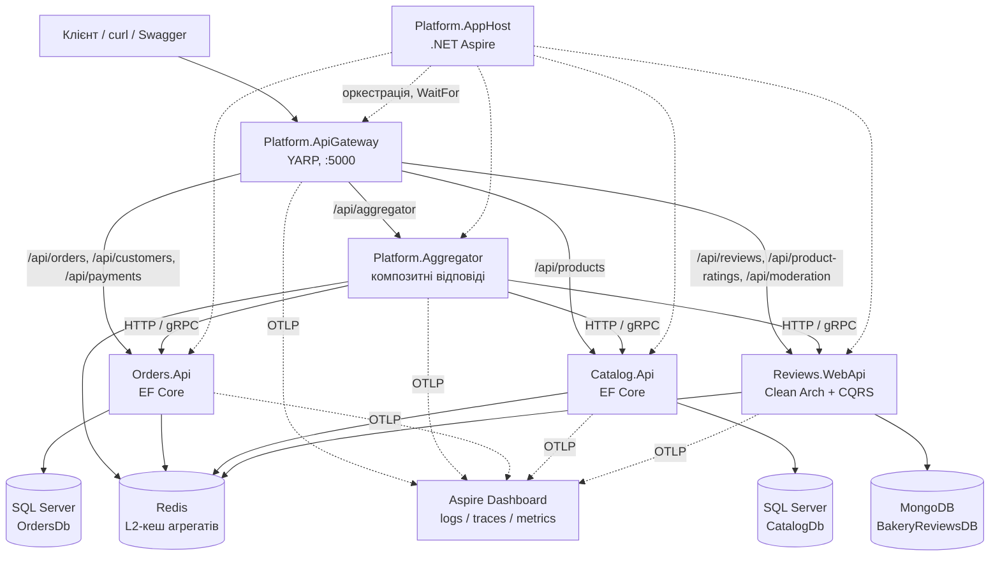
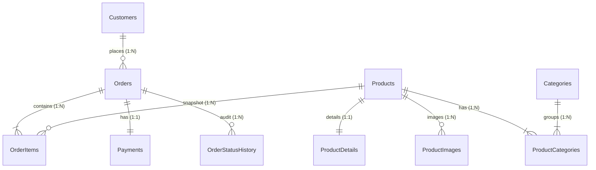

# Craft Bakery Platform — мікросервісна платформа крафтової пекарні

Навчальний семестровий проєкт із дисципліни **«Технології .NET у веб-інженерії»**.
Викладач: **Томка Ю.Я.** | Студент: **Казімір В.І.** (група 443-2).

Платформа складається з трьох бізнес-сервісів (`Catalog`, `Orders`, `Reviews`), API Gateway на YARP,
Aggregator композитних відповідей та спільних `Platform.ServiceDefaults`. Оркестрація — .NET Aspire
(`Platform.AppHost`): SQL Server, MongoDB і Redis у контейнерах з постійними volumes, порядок запуску
через `WaitFor`, трасування та логи в Aspire Dashboard.

---

## 1. Швидкий старт платформи (лабораторна №5)

Потрібні: **.NET SDK 10**, **Docker Desktop** (запущений), PowerShell або bash.

### 1.1. Пароль SQL Server — лише через secret, не в репозиторії

```bash
dotnet user-secrets set "Parameters:sql-password" "YourStrong!Passw0rd" --project Platform.AppHost
```

`Platform.AppHost/Program.cs` читає його як `builder.AddParameter("sql-password", secret: true)` і
передає в `AddSqlServer`. У репозиторії пароля немає: для Docker Compose він лежить у `.env`
(файл у `.gitignore`), поруч лежить шаблон `.env.example`.

### 1.2. Запуск усієї платформи однією командою

```bash
dotnet run --project Platform.AppHost
```

Aspire піднімає контейнери БД, застосовує міграції EF Core при старті сервісів, сіє демо-дані та
запускає сервіси → Aggregator → Gateway. У консолі друкуються адреса **Aspire Dashboard** і login-URL
з токеном — там видно стан ресурсів, логи, traces і metrics.

**API Gateway — єдина точка входу: `http://localhost:5000`.**

| Ресурс | Роль | Порт під Aspire | Порт окремого запуску (`--launch-profile http`) |
|---|---|---|---|
| `gateway` | YARP reverse proxy | **5000 (фіксований)** | 5000 |
| `aggregator` | композитні read-only відповіді | динамічний (див. Dashboard) | 5190 |
| `catalog-api` | товари й категорії, EF Core | динамічний | 5173 |
| `orders-api` | клієнти, замовлення, оплати, EF Core | динамічний | 5172 |
| `reviews-api` | відгуки, рейтинги, модерація, MongoDB | динамічний | 5180 |
| `sql` | SQL Server 2022, контейнер `dotnet-web-sql` | 1433 | 1433 |
| `mongo` | MongoDB 8.3, контейнер `dotnet-web-mongo` | 27017 | 27017 |
| `redis` | Redis 8 (лабораторна №6), контейнер `dotnet-web-redis` | 6379 | 6379 |

Під Aspire сервіси отримують динамічні порти — фактичні URL видно в Dashboard; фіксовані порти з
таблиці діють при окремому запуску проєкту. Gateway завжди на 5000, тому всі приклади нижче — через нього.

### 1.3. Перевірка після старту

```bash
curl http://localhost:5000/health
curl -H "X-Correlation-Id: demo-lab5" http://localhost:5000/api/products/category/1
curl http://localhost:5000/api/aggregator/products/1/overview
```

### 1.4. Альтернатива: уся інфраструктура одним стеком у Docker Desktop

`docker-compose.yml` — один проєкт `dotnet-web` з усіма базами та інфра-сервісами курсу:
одна кнопка Start/Stop у Docker Desktop замість окремих контейнерів.

| Сервіс | Образ | Порт (localhost) | Призначення |
|---|---|---|---|
| `sql` | mssql/server:2022-latest | 1433 | `CatalogDb` + `OrdersDb` |
| `mongo` | mongo:8.3 | 27017 | `BakeryReviewsDB`, одно-вузловий replica set `rs0` для транзакцій |
| `redis` | redis:8.6 | 6379 | L2-кеш лаби 6 |
| `rabbitmq` | rabbitmq:4-management-alpine | 5672 / 15672 | брокер лаби 8 + Management UI, профіль `messaging` |
| `keycloak-postgres` | postgres:16-alpine | — (лише в мережі стека) | база `keycloakdb` |
| `keycloak` | keycloak:26.0 | 8080 | IdP лаби 9, профіль `auth` |

```bash
cp .env.example .env              # задайте паролі; MSSQL_SA_PASSWORD має збігатися з паролем тома
docker compose up -d              # sql + mongo + redis — достатньо для лаб 6–7
docker compose --profile messaging up -d   # + rabbitmq (лаба 8)
docker compose --profile auth up -d        # + keycloak і його postgres (лаба 9, ~1.5 ГБ RAM)
docker compose ps
docker compose --profile messaging --profile auth down   # зупинити все; дані у volumes зберігаються
```

RabbitMQ і Keycloak за замовчуванням **не стартують**: у коді лаб 6–7 на них немає жодного
посилання, тож вони займають RAM лише тоді, коли явно увімкнені відповідним профілем.
Заповніть, однак, **усі** значення в `.env` (як в `.env.example`): Compose інтерполює весь файл,
тому обов'язкові змінні вимкнених профілів теж зупиняють `up -d`, якщо лишились порожніми.

Keycloak стартує в `start-dev` без TLS; логін і пароль адміна — у `.env`
(`KEYCLOAK_ADMIN_USER` / `KEYCLOAK_ADMIN_PASSWORD`), realm за планом лаби 9 — `BakeryRealm`.
Усі порти прив'язані до `127.0.0.1`, тож назовні нічого не дивиться.

**Імена контейнерів і томів збігаються з Aspire** (`dotnet-web-sql`, `dotnet-web-mongo`,
`dotnet-web-redis`, томи `dotnet-web-*-data`), тому дані спільні для обох способів запуску
й переживають перезапуск. **Не запускайте Compose та Aspire одночасно.** Щоб перейти з Aspire
на стек, спершу приберіть контейнери, які створив Aspire (дані лишаються в томах):

```bash
docker rm -f dotnet-web-sql dotnet-web-mongo dotnet-web-redis
docker compose up -d
```

Mongo у стеку піднімається з `--replSet rs0` і сам ініціює репліка-сет у healthcheck — на відміну
від Aspire-контейнера, де транзакції модерації недоступні. Учасник реплікації оголошений як
`localhost:27017`, тож резолвиться з хост-машини, де працюють сервіси.
Aspire створює тому Mongo з root-користувачем і вимагає TLS; compose-версія стартує без `--auth`
і без TLS, тому наявні користувачі ігноруються й сервіси підключаються без пароля (лише для dev).

Сервіси після цього запускаються окремо (`dotnet run --project Services/Orders/Orders.Api`).
Увага: fallback у `appsettings.json` для Catalog/Orders — **LocalDB**, а не compose-SQL, тому
в compose-режимі рядки підключення треба передати через змінні середовища:

```bash
export ConnectionStrings__CatalogDb="Server=localhost,1433;Database=CatalogDb;User Id=sa;Password=<MSSQL_SA_PASSWORD з .env>;TrustServerCertificate=True"
export ConnectionStrings__OrdersDb="Server=localhost,1433;Database=OrdersDb;User Id=sa;Password=<MSSQL_SA_PASSWORD з .env>;TrustServerCertificate=True"
export ConnectionStrings__redis="localhost:6379"
```

Reviews уже має fallback `mongodb://localhost:27017` і додаткових змінних не потребує.

---

## 2. Архітектура платформи



Та сама діаграма лежить у `docs/overall_architecture.mermaid`.

| Проєкт | Призначення |
|---|---|
| `Platform.AppHost` | Aspire-оркестрація: контейнери SQL/Mongo/Redis з `WithDataVolume`, secret-пароль SQL, бази `CatalogDb`/`OrdersDb`/`BakeryReviewsDB`, `WithReference` + `WaitFor`, фіксований порт Gateway |
| `Platform.ServiceDefaults` | спільні Serilog, OpenTelemetry, health checks, service discovery, CorrelationId middleware і DelegatingHandler |
| `Platform.ApiGateway` | YARP: маршрути й кластери за логічними іменами сервісів, логування маршрутизації |
| `Platform.Aggregator` | паралельні downstream-виклики, композитні DTO, часткові відмови з попередженнями |
| `Services/Catalog/*` | `.Api` / `.Bll` / `.Dal` / `.Domain`: товари, категорії, EF Core Code-First |
| `Services/Orders/*` | `.Api` / `.Bll` / `.Dal` / `.Domain`: клієнти, замовлення, оплати, історія статусів, EF Core |
| `Services/Reviews/*` | `.WebApi` / `.Application` / `.Infrastructure` / `.Domain`: Clean Architecture + CQRS (MediatR) + MongoDB |

**Database-per-Service.** Кожен сервіс має власну базу; імена баз збігаються з іменами рядків
підключення: `ConnectionStrings:CatalogDb`, `ConnectionStrings:OrdersDb`,
`ConnectionStrings:BakeryReviewsDB`. Aspire підставляє їх через `WithReference(database)` як
`ConnectionStrings__CatalogDb` тощо, тому `appsettings.json` містить лише локальний fallback.
Між базами немає фізичних FOREIGN KEY: `OrderItem` зберігає знімок товару (`ProductId`, `ProductName`,
`UnitPrice`), переданий у запиті створення замовлення, тож оформлення замовлення не читає Catalog.

**Порядок запуску.** `WaitFor` задає ланцюг: бази → сервіси → Aggregator → Gateway. Сервіси додатково
чекають Redis, а `EnableRetryOnFailure` у `AddDbContext` переживає холодний старт SQL-контейнера.

### 2.1. Platform.ServiceDefaults

`AddServiceDefaults(...)` підключає:

- **OpenTelemetry**: інструментація ASP.NET Core, HttpClient, SqlClient і MongoDB (`DiagnosticSource`
  через `MongoDbInstrumentation`), власні `ActivitySource` сервісів, `UseOtlpExporter()` за наявності
  `OTEL_EXPORTER_OTLP_ENDPOINT` (Aspire Dashboard); metrics — runtime, ASP.NET Core, HttpClient,
  SqlClient і Meter `Platform.Caching`.
- **Health checks**: `/alive` (live) і `/health` (усі перевірки, зокрема MongoDB у Reviews) через
  `MapDefaultEndpoints()`.
- **Service discovery** + `ConfigureHttpClientDefaults` з `AddServiceDiscovery` і
  `CorrelationIdPropagationHandler`.

`UsePlatformSerilog(serviceName)` налаштовує Serilog: збагачувачі `ServiceName`, `Environment`,
`MachineName`, `ThreadId`, `Enrich.FromLogContext()`, рівні за середовищем (Debug у Development,
Information інакше) з override для шумних категорій, `CompactJsonFormatter` у console sink і
`writeToProviders: true`, щоб логи йшли також в OpenTelemetry.

`UsePlatformDefaults(serviceName)` ставить `CorrelationIdMiddleware` і `UseSerilogRequestLogging`
(метод, шлях, статус, тривалість, `CorrelationId`).

### 2.2. Наскрізний CorrelationId

`CorrelationIdMiddleware` бере `X-Correlation-Id` із запиту або генерує новий, кладе його в
`HttpContext.Items`, у відповідь і в `LogContext` (властивості `CorrelationId`, `CorrelationOrigin`,
`UserId` з `X-User-Id`). Вихідні HTTP-запити отримують той самий заголовок через
`CorrelationIdPropagationHandler` (`DelegatingHandler`, зареєстрований у
`ConfigureHttpClientDefaults`), тому один ідентифікатор видно в логах Gateway, Aggregator і сервісу
та в spans траси.

### 2.3. API Gateway (YARP)

Маршрути й кластери описані в `Platform.ApiGateway/appsettings.json`; адреси кластерів —
`http://<ім'я-ресурсу>` і резолвляться через `AddServiceDiscoveryDestinationResolver()`.

| Префікс Gateway | Кластер | Order |
|---|---|---|
| `/api/aggregator` | `aggregator` | 100 (окремий маршрут на Aggregator) |
| `/api/orders`, `/api/customers`, `/api/payments` | `orders-api` | catch-all |
| `/api/products` | `catalog-api` | catch-all |
| `/api/reviews`, `/api/product-ratings`, `/api/moderation` | `reviews-api` | catch-all |

Порядок middleware: `CorrelationIdMiddleware` → `UseSerilogRequestLogging` → `RouteLoggingMiddleware`
→ `MapReverseProxy()`. `RouteLoggingMiddleware` після кожного запиту логує метод, шлях, `RouteId`,
`ClusterId`, статус і тривалість у мілісекундах разом із `CorrelationId`; unmatched-запити та 4xx/5xx
логуються як Warning/Error.

### 2.4. Aggregator

| Ендпоінт | Що збирає |
|---|---|
| `GET /api/aggregator/orders/{id}/full` | замовлення + клієнт + оплата + відгуки товарів замовлення |
| `GET /api/aggregator/products/{id}/overview` | картка товару + рейтинг + відгуки |
| `GET /api/aggregator/grpc/orders/{id}/full` | те саме через gRPC-клієнти (лабораторна №6) |

Незалежні downstream-запити виконуються паралельно (`Task.WhenAll`). Кожен типізований `HttpClient`
має явний `Timeout = 5 с` (`Platform.Aggregator/Program.cs`), тому недоступний сервіс не тягне за собою
стандартні 100 с очікування. Якщо один із сервісів недоступний, Aggregator повертає **200 із частковим
результатом і масивом `warnings`**, а не падає; критична відмова (замовлення не знайдено / Orders
лежить) дає 404/503. Бізнес-операції та downstream-виклики мають власні spans
(`AggregatorActivitySources`, `OrdersActivitySources`, `CatalogActivitySources`,
`ReviewsActivitySources`).

---

## 3. Приклади запитів через Gateway (`http://localhost:5000`)

```bash
# health Gateway
curl http://localhost:5000/health

# CorrelationId проходить крізь Gateway у сервіс і повертається у відповіді
curl -i -H "X-Correlation-Id: demo-lab5" http://localhost:5000/api/products/category/1

# клієнти та замовлення
curl http://localhost:5000/api/customers
curl -X POST http://localhost:5000/api/customers -H "Content-Type: application/json" \
  -d '{"firstName":"Оксана","lastName":"Бондар","email":"oksana.bondar@example.com","phoneNumber":"0981122334","gender":"F","age":26}'
curl -X POST http://localhost:5000/api/orders -H "Content-Type: application/json" \
  -d '{"customerId":1,"items":[{"productId":1,"productName":"Круасан масляний","unitPrice":45.0,"quantity":2}],"notes":"еко-пакет"}'
curl http://localhost:5000/api/orders/1
curl http://localhost:5000/api/orders/1/history
curl -X POST http://localhost:5000/api/payments -H "Content-Type: application/json" \
  -d '{"orderId":1,"paymentMethod":"ApplePay","amount":90.00}'

# відгуки й модерація
curl "http://localhost:5000/api/reviews?limit=2"
curl http://localhost:5000/api/product-ratings/1
curl "http://localhost:5000/api/moderation/logs?limit=5"

# композитні відповіді Aggregator
curl http://localhost:5000/api/aggregator/products/1/overview
curl http://localhost:5000/api/aggregator/orders/1/full
curl http://localhost:5000/api/aggregator/grpc/orders/1/full   # лаба №6: поки що 500, див. §4
```

Swagger кожного сервісу доступний через його власний порт (напр. `http://localhost:5173/swagger`
при окремому запуску); Gateway проксіює лише API-маршрути.

### 3.1. Перевірка часткової відмови (failure drill)

1. Зупиніть `reviews-api`: у Aspire Dashboard кнопка **Stop** на ресурсі, або завершіть процес
   (`taskkill /PID <pid> /T /F` для `dotnet run … Reviews.WebApi.csproj`).
2. Візьміть товар, який ще не агрегувався (кеш агрегатів живе 45 с і може віддати попередню повну
   відповідь): `curl http://localhost:5000/api/aggregator/products/3/overview`.
3. Очікуваний результат — **200** приблизно за 5 с, картка товару заповнена, `reviews: []`,
   рейтинг відсутній, три попередження:

   ```json
   {
     "productId": 3,
     "product": { "productId": 3, "name": "Чізкейк Сан-Себастьян", "categories": ["Хліб", "Випічка"] },
     "reviews": [],
     "warnings": [
       "«рейтингу товару 3» недоступний: таймаут вичерпано",
       "«схвалених відгуків товару 3» недоступний: таймаут вичерпано",
       "«найкращих відгуків товару 3» недоступний: таймаут вичерпано"
     ],
     "downstreamCalls": 3,
     "assemblyDurationMilliseconds": 5104.25
   }
   ```

4. Запустіть `reviews-api` знову (Dashboard **Start** або перезапуск AppHost) — наступний запит
   повертає повну відповідь без попереджень.

Те саме для `catalog-api`: огляд товару деградує до даних Reviews/Orders із попередженням.
Якщо товар не існує, відповідь — **404 ProblemDetails** з `correlationId` і `traceId` (перевірено:
`/api/aggregator/products/4/overview` → 404 «Товар не знайдено» за 0.14 с).

### 3.2. Бізнес-правила попередніх лабораторій (ті самі ендпоінти через Gateway)

```bash
# пагінація + фільтр + сортування замовлень клієнта
curl "http://localhost:5000/api/orders/customer/1?page=1&pageSize=5&sortBy=totalAmount&desc=false"
# недозволений перехід статусу → 409; повторна оплата → 409
curl -X PATCH http://localhost:5000/api/orders/1/status -H "Content-Type: application/json" -d '{"newStatus":"Baking"}'
# один товар у двох рядках → 400 ValidationProblemDetails (правило лише у FluentValidation)
curl -X POST http://localhost:5000/api/orders -H "Content-Type: application/json" \
  -d '{"customerId":1,"items":[{"productId":1,"productName":"Круасан","unitPrice":45.0,"quantity":2},{"productId":1,"productName":"Круасан","unitPrice":45.0,"quantity":3}]}'
# M:N категорії з фільтром за AddedAt
curl "http://localhost:5000/api/products/category/1?notEarlierThan=2030-01-01T00:00:00Z"
# ETag / If-Match: оновлення зі старим ETag → 409
curl -i http://localhost:5000/api/reviews/<id>
curl -X PUT http://localhost:5000/api/reviews/<id> -H 'If-Match: W/"1"' -H "Content-Type: application/json" \
  -d '{"comment":"Оновлений текст","taste":5,"freshness":4,"aroma":5,"tags":["хрусткий"]}'
# модерація в транзакції MongoDB
curl -X POST http://localhost:5000/api/moderation/reviews/<id> -H "Content-Type: application/json" \
  -d '{"action":"Approved","moderator":"admin_olya","notes":"Правила не порушено"}'
```

---

## 4. Лабораторна №6: gRPC та дворівневе кешування

Redis додається в AppHost через `AddRedis("redis").WithDataVolume("dotnet-web-redis-data")`; сервіси й
Aggregator отримують його через `WithReference(redis)` + `AddRedisDistributedCache("redis")`.

- **L1** — `IMemoryCache` у `Caching/` кожного сервісу (`SizeLimit = 10_000`, `Size = 1`,
  sliding 30 с, absolute = TTL типу даних, cache-aside). **L2** — Redis через `IDistributedCache`;
  DTO серіалізуються `System.Text.Json`, ключі з префіксами сервісів (`CacheKeys`). Рівні заповнюються
  на зворотному шляху L1 → L2 → БД, TTL L1 коротший за L2.
- Інвалідація одразу після запису: `POST/PUT/DELETE` відгуків видаляють пов'язані ключі синхронно з
  операцією, причина логується (`CacheInvalidated key=… reason=…`). Масові перейменування
  (`PUT by-product/{id}`, `PUT by-customer/{id}`) інвалідують ключі самих відгуків і списку відгуків
  товару; агрегат `aggregate:order:{id}:full` вони не чіпають — він доживає свої 45 с TTL.
- Aggregator кешує повні відповіді в Redis на 45 с, перевіряє кеш **до** gRPC-викликів і **не кешує**
  часткові результати з попередженнями.
- Контракти: `Protos/catalog.proto`, `Protos/orders.proto`, `Protos/reviews.proto` у кожному сервісі;
  сервери — `Grpc/*GrpcService.cs` (адаптери над BLL/`ISender`, `InvalidArgument`/`NotFound` замість
  `Internal`), реєстрація `AddGrpc` + `MapGrpcService`. Клієнти Aggregator — типізовані `AddGrpcClient`
  з service discovery і `GrpcClientLoggingInterceptor`; незалежні виклики паралельні, `Unavailable` /
  `DeadlineExceeded` перетворюються на частковий результат або 503.
- Метрики кешу: Meter `Platform.Caching`, лічильники `cache.hits` / `cache.misses` з тегами `level`
  (L1/L2) і `cache`; Meter зареєстрований у `ServiceDefaults` через `.AddMeter("Platform.Caching")`.

### 4.1. h2c: окремий HTTP/2-only ендпоінт

Kestrel без TLS на `Http1AndHttp2` опускається до HTTP/1.1 («Otherwise, the connection defaults to
HTTP/1.1»), тому gRPC слухає **власний** ендпоінт з `Protocols: Http2`. Порти оголошені в
`appsettings.json` кожного сервісу й продубльовані в AppHost через
`WithHttpEndpoint(port, targetPort, isProxied: false)` — Aspire запускає проєкти з
`--no-launch-profile`, тож без явних портів Kestrel-конфіг і service discovery роз'їхалися б.

| Сервіс | REST (`Http1AndHttp2`) | gRPC (`Http2`) |
|---|---|---|
| Orders.Api | 5172 | 5272 |
| Catalog.Api | 5173 | 5273 |
| Reviews.WebApi | 5180 | 5280 |

gRPC-ендпоінт позначений `ExcludeReferenceEndpoint = true`, щоб звичайний `WithReference(svc)` не
підмішував його в REST-резолвінг; Aggregator підключає його явно —
`.WithReference(orders.GetEndpoint("grpc"))`. Адреси клієнтів — `http://_grpc.orders-api`: у Aspire
`_` відділяє ім'я ендпоінта від імені сервісу. `isProxied: false` обов'язковий, бо для неконтейнерних
ресурсів Aspire не вміє проксювати ендпоінт, у якого `Port == TargetPort`.
`AppContext.SetSwitch("System.Net.Http.SocketsHttpHandler.Http2UnencryptedSupport", true)` лишається
потрібним для plaintext HTTP/2.

### 4.2. Перевірено на живій платформі (17.11.2026)

| Перевірка | Результат |
|---|---|
| `GET /api/aggregator/orders/1/full` (REST) | 200, `downstreamCalls: 8` |
| `GET /api/aggregator/grpc/orders/1/full` | 200, `cached: false`; повторний виклик — `cached: true` |
| Ціни з gRPC | `60.00` і `160.00` — invariant culture, без помилкового ×100 |
| Redis `aggregate:order:1:full` | TTL рівно 45 с |
| `PUT /api/reviews/by-product/1` | інвалідовано `reviews:review:{id}` і `reviews:product:1:reviews`, reason `product-renamed` |
| Логи кешу | `CacheHit level=L1`, `CacheHit level=L2`, `CacheMiss key=…` |
| Server interceptor | `gRPC ok method="/bakery.catalog.v1.CatalogService/GetProduct" peer="ipv6:[::1]:51305" status=OK elapsed=21ms` |
| Reviews зупинено | 200 + `warnings: ["reviews:product:3 unavailable (Unavailable)"]`; частковий агрегат у Redis не записаний |
| Orders зупинено | 503 ProblemDetails «gRPC service orders is unavailable», не 500 |

Redis в Aspire 13.6 піднімається з TLS і паролем, тому прямий `redis-cli` без `--tls` дає
«Connection reset by peer»; ключі перевіряються так:
`docker exec dotnet-web-redis sh -c 'redis-cli --tls --insecure -a "$REDIS_PASSWORD" --no-auth-warning TTL "aggregate:order:1:full"'`.

---

## 5. Сервіси та дані

### 5.1. Catalog (EF Core)

Шари `.Domain` → `.Dal` → `.Bll` → `.Api`. `CatalogDbContext` + `IEntityTypeConfiguration<T>`,
`GenericRepository<T>` зі специфікаціями (`WithSpecification` віддає `IQueryable<T>`), `UnitOfWork`,
AutoMapper, FluentValidation у BLL. Ендпоінти: `GET /api/products/{id}` (картка товару),
`GET /api/products/category/{categoryId}?notEarlierThan=` (M:N `ProductCategory` з фільтром `AddedAt`).

### 5.2. Orders (EF Core)

Ті самі шари; сутності `Customers`, `Orders`, `OrderItems`, `Payments`, `OrderStatusHistories`.
`OrderItem` — знімок товару, без навігації в Catalog. Ендпоінти: `/api/customers` (CRUD),
`/api/orders` (CRUD + `customer/{id}` пагінація + `{id}/history` explicit loading + `{id}/status`
state machine + `{id}/cancel`), `/api/payments` (`POST`, `GET order/{orderId}`).

### 5.3. Reviews (Clean Architecture + CQRS + MongoDB)

| Проєкт | Що покладено |
|---|---|
| `Reviews.Domain` | сутності `Review`/`ProductRating`/`ModerationLog`, незмінні VO, доменні винятки, інтерфейси репозиторіїв |
| `Reviews.Application` | команди/queries через MediatR, конвеєр біхавіорів `ExceptionHandling → Validation → Logging → Caching → Performance`, валідатори, `AddApplication()` |
| `Reviews.Infrastructure` | `MongoDbContext`, `BsonClassMap` + конвенції, репозиторії, транзакції, індекси, ідемпотентний сід, health check |
| `Reviews.WebApi` | тонкі контролери (`ISender.Send`), ETag/If-Match, ProblemDetails, Swagger |

Колекції `reviews`, `product_ratings`, `moderation_logs`; денормалізований `averageRating`,
cursor-пагінація на боці MongoDB, optimistic concurrency через `version` → ETag `W/"n"`,
модерація й видалення — в транзакції репліка-сету.

### 5.4. ERD



`OrdersDb`: `Customers`, `Orders`, `OrderItems` (знімок `ProductName`/`UnitPrice`), `Payments`,
`OrderStatusHistory`. `CatalogDb`: `Products`, `Categories`, `ProductCategories` (`AddedAt`),
`ProductDetails`, `ProductImages`. `BakeryReviewsDB`: документні колекції з §5.3.

### 5.5. Міграції та сід

```bash
dotnet ef migrations add <Name> --project Services/Catalog/Catalog.Dal --startup-project Services/Catalog/Catalog.Api
dotnet ef migrations add <Name> --project Services/Orders/Orders.Dal --startup-project Services/Orders/Orders.Api
dotnet ef database update --project Services/Orders/Orders.Dal --startup-project Services/Orders/Orders.Api
```

Міграції застосовуються автоматично при старті (`MigrateAsync`), у Development далі виконується
ідемпотентний сід. Якщо в базі лишилася схема лабораторних 1–2 без `__EFMigrationsHistory`, сервіс
кидає зрозуміле повідомлення з командою `dotnet ef database drop -f ...` (захист у `Program.cs`).

### 5.6. Скрипти лабораторної №1

```text
db/
├── p1/    # Orders: schema.sql · procedures.sql · seed.sql
├── p2/    # Catalog: schema.sql · seed.sql
└── p3/    # MongoDB: collections.js · seed.js
```

MongoDB для транзакцій потрібен як одно-вузловий репліка-сет `rs0` (`mongod --replSet rs0` +
`rs.initiate()`); від лабораторної №4 індекси й сід виконує сам сервіс (`MongoIndexInitializer`,
`MongoDataSeeder`), тому ручні скрипти не обов'язкові.

### 5.7. Політика дублювання даних між базами (Data Duplication Policy)

Між `CatalogDb`, `OrdersDb` і `BakeryReviewsDB` **немає фізичних FOREIGN KEY**: усі міжсервісні
посилання — числові `Id`, кожна база належить рівно одному сервісу (Database-per-Service).

| Дані | База-власник (Master) | Де дублюється (Replica) | Мета дублювання | Механізм узгодженості |
|---|---|---|---|---|
| `UnitPrice` | `CatalogDb.Products` | `OrdersDb.OrderItems` | Сума чеку не змінюється, коли каталог переоцінює товар | **Знімок:** `Order.AddItem` копіює ціну в момент створення замовлення |
| `ProductName` | `CatalogDb.Products` | `OrdersDb.OrderItems` | Чек і список позицій формуються без звернення до Catalog | **Знімок:** `Order.AddItem` копіює назву в момент покупки |
| `ProductName` | `CatalogDb.Products` | `BakeryReviewsDB.reviews` | Видача списку відгуків без міжсервісного join | **Знімок:** `Review.Create`; перейменування товару не переноситься на вже написані відгуки |
| `CustomerName` | `OrdersDb.Customers` | `BakeryReviewsDB.reviews` | Показ автора відгуку без звернення до бази клієнтів | **Знімок:** `Review.Create` |
| `averageRating` | `BakeryReviewsDB.reviews` | `BakeryReviewsDB.product_ratings` | Швидка видача рейтингу товару без агрегації щоразу | **Перерахунок:** `ProductRatingRepository.RecalculateAsync` у транзакції модерації/видалення |

Актуальні дані каталогу в замовлення не копіюються взагалі — їх komponує Aggregator під час
читання (`GET /api/aggregator/products/{id}/overview`, `GET /api/aggregator/orders/{id}/full`).
Подієва узгодженість (`ProductCatalogUpdatedEvent`, `ProductRenamedEvent`,
`CustomerProfileUpdatedEvent`) у проєкті **не реалізована**: історичні копії є навмисними
знімками, а не репліками, які потрібно синхронізувати. Локального довідника `Products`
у `OrdersDb` теж немає — сервіс замовлень не зберігає каталог.

Опис контекстів і початкова редакція політики — у `docs/contexts_description.md`.

---

## 6. Відповідність критеріям лабораторних №5 і №6

### 6.1. Лабораторна №5

| Критерій | Де в коді |
|---|---|
| Контейнери SQL/Mongo з постійним сховищем, пароль-секрет, імена баз = рядки підключення | `Platform.AppHost/Program.cs` (`AddParameter(secret: true)`, `WithDataVolume`, `AddDatabase`), `docker-compose.yml`, `appsettings.json` сервісів |
| `WithReference` + `WaitFor`, порядок БД → сервіси → Aggregator → Gateway, фіксований порт Gateway | `Platform.AppHost/Program.cs` |
| `AddServiceDefaults` + `MapDefaultEndpoints`, рядки з конфігурації, `/api/{domain}` | `Program.cs` трьох сервісів, контролери з `[Route("api/...")]` |
| Бізнес-логи та власні spans | `*/Diagnostics/*ActivitySources.cs`, `Log.Information` з `OrderId`/`Status` у сервісах і Aggregator |
| Serilog: збагачувачі, `FromLogContext`, рівні за середовищем, `CompactJsonFormatter`, `writeToProviders` | `Platform.ServiceDefaults/Extensions.cs` (`UsePlatformSerilog`) |
| CorrelationId: middleware + вихідний DelegatingHandler | `Platform.ServiceDefaults/CorrelationIdMiddleware.cs`, `CorrelationIdPropagationHandler.cs`, реєстрація в `ConfigureHttpClientDefaults` |
| OTel: HTTP, SQL, MongoDB + OTLP | `Platform.ServiceDefaults/Extensions.cs` (`ConfigureOpenTelemetry`), `MongoDbInstrumentation.cs` |
| YARP маршрути/кластери з логічними іменами, service discovery resolver | `Platform.ApiGateway/appsettings.json`, `Program.cs` |
| CorrelationId перед `MapReverseProxy`, логи метод/шлях/маршрут/статус/тривалість | `Platform.ApiGateway/Program.cs`, `RouteLoggingMiddleware.cs` |
| Aggregator: паралельні виклики, часткові відмови, попередження | `Platform.Aggregator/Services/*`, `Clients/DownstreamClient.cs`, `Controllers/AggregationController.cs` |
| Таймаут downstream-викликів 5 с → деградація за 5 с, а не 100 с | `Platform.Aggregator/Program.cs` (`client.Timeout`) |
| Політика дублювання даних між базами, Database-per-Service без фізичних FK | README §5.7, `Order.AddItem`, `Review.Create`, `docs/contexts_description.md` |
| README з інструкцією запуску | цей файл, §1 і §3 |

**Перевірено на живій платформі** (Aspire + Docker, gateway `:5000`):

- `/health` → 200; картка `/api/products/1` → `productId: 1`, `categories: ["Випічка","Десерти"]`.
- Наскрізний `X-Correlation-Id: lab6-e2e` видно в логах усіх п'яти процесів: Gateway, Aggregator,
  Catalog.Api, Orders.Api, Reviews.WebApi.
- Бізнес-логи повертаються з `SourceContext` сервісу: `OrderService` («Створено замовлення…»),
  `PaymentService` («Оплата … проведена…»), `CreateReviewCommandHandler` («Відгук … створено…»),
  `ProductService` («Каталог: товар …»).
- Записи крізь Gateway: `POST /api/orders` → 201 (total 90.00), `POST /api/payments` → 201,
  `POST /api/reviews` → 201; повторний відгук того самого клієнта на той самий товар → 400.
- Failure drill: `reviews-api` зупинено → огляд товару **200 + 3 warnings за 5.1 с** (§3.1).
- Дані переживають перезапуск AppHost: замовлення 2 і 3 у SQL, відгук у MongoDB лишаються на місці
  (`WithDataVolume`).
- `dotnet build Platform.slnx` → 0 помилок, 7 відомих warning (NU1903/NU1904, ASPIRE010).

### 6.2. Лабораторна №6 (14 критеріїв → 11 балів)

Ваги й тип перевірки взяті з вкладки «Критерії» на tomka.pp.ua. `ШІ` — перевіряє ШІ-асистент,
`AST` — статичний аналіз коду.

| № | Критерій | Вага | Тип | Де в коді |
|---|---|---|---|---|
| 1 | Redis в AppHost з постійним сховищем і посиланнями | 0.6 | ШІ | `Platform.AppHost/Program.cs`: `AddRedis("redis").WithDataVolume(...)`, `WithReference(redis).WaitFor(redis)` у трьох сервісах і Aggregator |
| 2 | `.proto` підключені в проєкти (Server / Client) | 0.6 | AST | `Services/*/*.Api/Protos/*.proto` + `<Protobuf GrpcServices="Server">` у трьох `.csproj`; `Platform.Aggregator.csproj` — ті самі файли з `GrpcServices="Client"` |
| 3 | `IMemoryCache` з `SizeLimit` і політиками витіснення | 0.7 | ШІ | `Catalog.Api/Program.cs`, `Orders.Api/Program.cs`, `Reviews.Application/DependencyInjection.cs` (`AddMemoryCache(o => o.SizeLimit = 10_000)`); `*/Caching/TwoLevelCacheService.cs` (`Size = 1`, sliding 30 с, absolute = TTL) |
| 4 | Cache-aside для read-heavy операцій з передбачуваними ключами | 0.9 | ШІ | `*/Caching/TwoLevelCacheService.cs` (кеш → БД → запис), `*/Caching/CacheKeys.cs` (`catalog:product:{id}`), логи `CacheHit` / `CacheMiss` |
| 5 | Інвалідація кешу одразу після запису | 0.7 | ШІ | `Reviews.Application/Commands/{CreateReview,UpdateReview,DeleteReview,RenameProduct,ChangeCustomerName}Command.cs`, `TwoLevelCacheService.RemoveAsync` (логує `reason`) |
| 6 | `IDistributedCache` поверх Redis через Aspire | 0.9 | ШІ | `AddRedisDistributedCache("redis")` у `Catalog.Api/Program.cs`, `Orders.Api/Program.cs`, `Reviews.WebApi/Program.cs`, `Platform.Aggregator/Program.cs`; `System.Text.Json` + префікси в `CacheKeys` |
| 7 | Дворівневий кеш L1 → L2 → БД | 1.0 | ШІ | `*/Caching/TwoLevelCacheService.cs` (зворотне заповнення рівнів, TTL L1 < L2); `Reviews.Application/Behaviors/CachingBehavior.cs` + `ICacheableQuery` |
| 8 | Protocol Buffers контракти для доменних сутностей | 0.8 | AST | `Protos/{catalog,orders,reviews}.proto`: `proto3`, `package`, `csharp_namespace`, `service` + `rpc`, `message` з номерами полів |
| 9 | gRPC-сервіси як адаптери над BLL з `RpcException` | 1.1 | ШІ | `Services/*/Grpc/*GrpcService.cs` (базовий згенерований клас, валідація, `NotFound`/`InvalidArgument`), `AddGrpc` + `MapGrpcService` у `Program.cs`, HTTP/2-ендпоінт (§4.1) |
| 10 | Типізовані gRPC-клієнти Aggregator із service discovery | 0.7 | ШІ | `Platform.Aggregator/Program.cs`: три `AddGrpcClient<>` з адресами `http://_grpc.{orders,catalog,reviews}-api` |
| 11 | Паралельні gRPC-виклики з обробкою часткових відмов | 1.1 | ШІ | `Platform.Aggregator/Services/GrpcOrderAggregateService.cs`: `Task.WhenAll`, `CancellationToken` у кожному виклику, `Unavailable`/`DeadlineExceeded` → `warnings` або 503 |
| 12 | Кеш агрегованої відповіді в Redis з коротким TTL | 0.6 | ШІ | `Platform.Aggregator/Caching/AggregatedCache.cs` (`aggregate:order:{id}:full`, TTL 45 с); перевірка до викликів і `warnings.IsEmpty` перед записом у `GrpcOrderAggregateService` |
| 13 | Серверний interceptor для логування gRPC-викликів | 0.6 | ШІ | `Services/*/Grpc/GrpcLoggingInterceptor.cs` (метод, peer, статус, тривалість), клієнтський — `Platform.Aggregator/GrpcClients/GrpcClientLoggingInterceptor.cs` |
| 14 | Метрики попадань і промахів кешу через `Meter` | 0.7 | ШІ | `*/Caching/CacheMetrics.cs` + `Platform.Aggregator/Caching/AggregatedCache.cs` (`cache.hits`/`cache.misses`, тег `level`), `.AddMeter("Platform.Caching")` у `Platform.ServiceDefaults/Extensions.cs` |

### 6.3. Лабораторна №7 (12 критеріїв → 9 балів)

| № | Критерій | Вага | Де реалізовано / Що перевіряється |
|---|---|---|---|
| 1 | Standard Resilience Handler для всіх клієнтів без нашарування | 0.6 | `Platform.ServiceDefaults/Extensions.cs`: `ConfigureHttpClientDefaults` + `AddStandardResilienceHandler`. Для кастомних/gRPC-клієнтів викликається `RemoveAllResilienceHandlers()` перед власною політикою. |
| 2 | Retry-політика gRPC-клієнтів за gRPC-статусами | 0.8 | `Platform.Aggregator/Program.cs`: `ServiceConfig` з `MethodConfig` і `RetryPolicy` (`MaxAttempts`, exponential backoff, `RetryableStatusCodes`: `Unavailable`, `DeadlineExceeded`). |
| 3 | Налаштовані retry, circuit breaker і таймаути | 1.1 | `Platform.ServiceDefaults/Extensions.cs`: exponential backoff, jitter, `DisableForUnsafeHttpMethods()`; `CircuitBreaker` (`FailureRatio=0.5`, `MinimumThroughput=10`, `BreakDuration=15s`, `OnOpened`/`OnClosed`/`OnHalfOpened` логи); узгоджені таймаути. |
| 4 | Різні політики для критичних і некритичних сервісів з обґрунтуванням | 0.8 | `Platform.Aggregator/Program.cs`: Critical (`Orders`, `Catalog`) — 5 спроб, backoff 1s→5s, чутливий breaker; Non-critical (`Reviews`) — 2 спроби, backoff 500ms→2s для швидкого failover. Таблиця обґрунтування нижче. |
| 5 | Graceful degradation кешу Redis | 0.8 | `*/Caching/TwoLevelCacheService.cs` + `AggregatedCache.cs`: збої перехоплюються, логується Warning, лічильник `cache.redis.failures`, читання напряму з джерела/БД. |
| 6 | Клас бізнес-метрик з лічильниками через `IMeterFactory` | 0.9 | `Services/*/*/Metrics/` (`OrdersMetrics`, `CatalogMetrics`, `ReviewsMetrics`, `AggregatorMetrics`): зареєстровані Singleton, лічильники створені через `IMeterFactory`, назви `orders.created`, `reviews.created` тощо; OTel `.AddMeter(...)` у ServiceDefaults. |
| 7 | Гістограми тривалості та gauge з низькою кардинальністю | 0.9 | `Metrics/*`: гістограми тривалості операцій (`orders.duration`, `products.duration`, `reviews.operation.duration`, `aggregate.duration`) для успішних і невдалих операцій; `ObservableGauge` (`orders.pending`, `products.available`, `reviews.moderation.pending`); теги з низькою кардинальністю (без Id користувачів). |
| 8 | Health checks SQL Server і MongoDB з іменами, тегами й таймаутом | 0.7 | `HealthChecks/*` у сервісах: `AddSqlServer` (`orders-sql`, `catalog-sql`) і `AddMongoDb` (`reviews-mongo`) з тегами `database` та `ready`, timeout 5s. |
| 9 | Health check Redis зі статусом `Degraded` | 0.4 | `HealthChecks/*` у сервісах і Aggregator: `AddRedis` з `failureStatus: HealthStatus.Degraded`, теги `cache`, `ready`, timeout 3s. Недоступність кешу не робить сервіс Unhealthy. |
| 10 | gRPC Health Checking Protocol і перевірка залежностей в Aggregator | 0.8 | `Services/*`: `AddGrpcHealthChecks()` + `MapGrpcHealthChecksService()`. `Platform.Aggregator/HealthChecks/DownstreamGrpcHealthCheck.cs`: реалізація `IHealthCheck` через `Health.HealthClient` з коротким дедлайном 2s. |
| 11 | Розділені liveness і readiness endpoints з деталями | 0.8 | `Platform.ServiceDefaults/Extensions.cs`: `/health/live` (тег `live`), `/health/ready` (тег `ready`, JSON-деталі), `/health` (усі чеки). Доступні **в усіх середовищах** (не обмежені `IsDevelopment()`). |
| 12 | AppHost показує стан ресурсів через `WithHttpHealthCheck` | 0.4 | `Platform.AppHost/Program.cs`: `.WithHttpHealthCheck("/health/ready")` для `orders`, `catalog`, `reviews`, `aggregator`, `gateway`. `WaitFor` чекає на здоровий сервіс. |

#### Таблиця профілів резильєнтності (Critical vs Non-Critical)

| Сервіс / Клієнт | Профіль | MaxAttempts | Initial Backoff | Max Backoff | Breaker FailureRatio | Breaker BreakDuration | Timeout | Обґрунтування |
|---|---|---|---|---|---|---|---|---|
| **Orders.Api** | Critical | 5 | 1.0 s | 5.0 s | 0.3 (чутливий) | 15 s | 3 s | Оформлення замовлення є ядром бізнесу. Втрата запиту веде до втрати прибутку. Допустимо витратити більше часу на спроби відновлення з'єднання. |
| **Catalog.Api** | Critical | 5 | 1.0 s | 5.0 s | 0.3 (чутливий) | 15 s | 3 s | Без актуальних цін та наявності товарів оформлення замовлення неможливе. Висока критичність доступності. |
| **Reviews.WebApi** | Non-Critical | 2 | 0.5 s | 2.0 s | 0.7 (м'який) | 10 s | 2 s | Відгуки та рейтинги є другорядним контентом. Якщо сервіс недоступний, Aggregator повинен негайно віддати partial response з попередженням, не сповільнюючи користувача. |

Сума ваг: інфраструктура 1.2 + локальне кешування 2.3 + розподілене 1.9 + gRPC-сервіси 1.9 +
Aggregator 2.4 + обсервабіліті 1.3 = **11.0**.

Живі докази по критеріях 4, 5, 9, 11, 12 — у §4.2.

### 6.4. Лабораторна №8 (13 критеріїв → 11 балів)

Подієва мікросервісна архітектура на основі брокера повідомлень RabbitMQ.

| № | Критерій | Вага | Де реалізовано / Що перевіряється |
|---|---|---|---|
| 1 | RabbitMQ в AppHost з volume і Management UI | 0.6 | `Platform.AppHost/Program.cs`: `AddRabbitMQ("messaging").WithContainerName("dotnet-web-rabbitmq").WithDataVolume("dotnet-web-rabbitmq-data").WithManagementPlugin()`. Підключено `.WithReference(messaging).WaitFor(messaging)` до Catalog, Orders та Reviews. |
| 2 | Підключення через `Aspire.RabbitMQ.Client` (RabbitMQ.Client 7.x) | 0.4 | `Platform.EventBus`: `Aspire.RabbitMQ.Client` (13.6.4) та `RabbitMQ.Client` (7.2.2). У `Program.cs` сервісів Catalog, Orders, Reviews: `builder.AddRabbitMQClient("messaging")` реєструє `IConnection` з health check; асинхронний API `IChannel` (`CreateChannelAsync`, `BasicPublishAsync`, `BasicConsumeAsync`). |
| 3 | Декларативна топологія при старті: topic exchange, черги, bindings, DLX/DLQ | 1.1 | `Platform.EventBus/Topology/`: `RabbitMqTopologyHostedService` декларує topic exchange `platform.events`, dead-letter exchange `platform.events.dlx`, окремі черги для кожного споживача (`q.orders.catalog-events`, `q.reviews.catalog-events`, `q.catalog.review-events`) з аргументами `x-dead-letter-exchange`, та DLQ (`<queue>.dlq`). |
| 4 | Незмінні integration events з `EventId` і `CorrelationId` | 0.8 | `Platform.EventBus/Events/IntegrationEvent.cs`: абстрактний незмінний record з `EventId` (Guid), `OccurredAt` (DateTimeOffset), `CorrelationId` (string). Доменні події у минулому часі (`ProductCreatedEvent`, `ProductRenamedEvent`, `ProductPriceChangedEvent`, `CategoryUpdatedEvent`, `OrderPlacedEvent`, `OrderStatusChangedEvent`, `PaymentProcessedEvent`, `ReviewCreatedEvent`, `ReviewModeratedEvent`). |
| 5 | `IEventPublisher` з persistent-публікацією в JSON | 1.0 | `Platform.EventBus/Publishing/RabbitMqEventPublisher.cs`: серіалізація camelCase JSON; `BasicProperties` з `DeliveryModes.Persistent`, `ContentType = "application/json"`, `MessageId = EventId`, `Type = EventTypeName`, `x-correlation-id = CorrelationId`; структуроване логування публікації. |
| 6 | Події публікуються лише після успішного збереження змін | 0.8 | `ProductService.cs`, `OrderService.cs`, `PaymentService.cs`, `CreateReviewCommandHandler.cs`, `ModerateReviewCommandHandler.cs`: публікація `eventPublisher.PublishAsync(...)` викликається виключно після успішного `SaveChangesAsync()` / `Commit()`. При збої транзакції подія не публікується. |
| 7 | Consumer як `BackgroundService` з ручним підтвердженням | 1.0 | `Platform.EventBus/Consuming/RabbitMqConsumerBackgroundService.cs`: спадкоємець `BackgroundService`, налаштування `BasicQosAsync(prefetchCount: 10)`, `AsyncEventingBasicConsumer`, `BasicConsumeAsync(autoAck: false)`, коректне завершення за `stoppingToken`. |
| 8 | Ack після успіху, Nack без requeue для постійних збоїв | 0.8 | `RabbitMqConsumerBackgroundService.cs`: успішна обробка підтверджується `BasicAckAsync(deliveryTag, false)`; невідомі/несумісні формати та постійні помилки відправляються у DLQ через `BasicNackAsync(deliveryTag, false, requeue: false)` з логуванням. |
| 9 | Ідемпотентні обробники з таблицею оброблених подій | 1.1 | Кожен обробник подій (`IntegrationEvents/Handlers/`) перевіряє наявність `EventId` у таблиці `ProcessedEvents` (SQL) або колекції `processed_events` (MongoDB) в межах тієї ж транзакції та пропускає дублікати. |
| 10 | Реплікація копій даних за політикою дублювання Лаб. 01 | 1.1 | `Orders.Api`: оновлення локального довідника товарів `dbo.Products` (без перезапису цін у оформлених `OrderItems`); `Reviews.WebApi`: оновлення денормалізованої `productName` у всіх відгуках товару; `Catalog.Api`: синхронізація рейтингу та кількості відгуків. |
| 11 | Повтори з лічильником `x-retry-count` і максимумом спроб | 0.9 | `RabbitMqConsumerBackgroundService.cs`: при збоях витягує заголовок `x-retry-count`, якщо `< 3` — перепубліковує зі збільшеним лічильником та робить Ack оригіналу; при перевищенні ліміту — Nack без requeue для потрапляння в DLQ. |
| 12 | Передача контексту трасування через брокер | 1.0 | `RabbitMqEventPublisher.cs`: додає заголовок `traceparent` до властивостей повідомлення. `RabbitMqConsumerBackgroundService.cs`: витягує W3C traceparent і створює `Activity` типу `ActivityKind.Consumer` з тегами `messaging.system = "rabbitmq"`, `messaging.destination = queueName`, `messaging.operation = "receive"`. Додано `AddSource("Platform.EventBus")` у `Platform.ServiceDefaults`. |
| 13 | Структуроване логування збоїв з бізнес-контекстом | 0.4 | `EventId`, тип події, ідентифікатори сутностей (`ProductId`, `OrderId`, `ReviewId`), `CorrelationId` фіксуються у логах обробки та помилок. |

### 6.5. Лабораторна №9 (13 критеріїв → 13 балів)

Аутентифікація та авторизація в мікросервісній архітектурі: ASP.NET Identity + JWT, IdentityServer, Keycloak + Pulumi.

| № | Критерій | Вага | Де реалізовано / Що перевіряється |
|---|---|---|---|
| 1 | Auth Service на ASP.NET Identity з окремою базою через Aspire | 0.8 | `Services/Auth/Auth.Api`: `ApplicationDbContext` з базою `IdentityDb` через Aspire; `ApplicationUser : IdentityUser`, налаштування паролів та блокування (lockout). Згенеровано міграції `InitialIdentity`. |
| 2 | JWT-сервіс: access 15 хв і refresh 7 днів з ротацією | 1.4 | `Services/Auth/Auth.Api/Services/JwtTokenService.cs`: claims `sub`, `username`, `roles`, `email`, `jti`; refresh-токени зберігаються в БД; при кожному оновленні старий токен відкликається (`RevokedAt`), новий видається в `HttpOnly` cookie. |
| 3 | Ендпоінти register / login / refresh-token / revoke-token / logout | 1.1 | `Services/Auth/Auth.Api/Endpoints/AuthEndpoints.cs`: реєстрація надає роль `User`; login повертає access token у тілі відповіді та refresh token у HttpOnly cookie; revoke та logout відкликають токен та очищають cookie. |
| 4 | Підтвердження email, відновлення та зміна пароля | 1.0 | `AuthEndpoints.cs`: `verify-email` та `resend-verification` (вхід заблоковано для непідтверджених email: `RequireConfirmedEmail = true`); `forgot-password` та `reset-password` (при скиданні пароля ревокуються ВСІ активні refresh-токени); `change-password`. |
| 5 | Ролі `User` / `Admin` та захищені ендпоінти `/users` | 0.8 | `Services/Auth/Auth.Api/Endpoints/UsersEndpoints.cs`: ролі створюються при старті; ендпоінти `/users` (list, delete) доступні лише для `Admin`; перегляд та редагування дозволені лише `Admin` або власнику акаунта. |
| 6 | Gateway маршрутизує `/auth` і `/users`, мікросервіси валідують JWT | 0.8 | `Platform.ApiGateway/appsettings.json`: YARP-маршрути `/auth/{**catch-all}` та `/users/{**catch-all}` на `auth-api`, `/api/payments/{**catch-all}` на `payments-api`; `AddPlatformAuthentication` та `AddPlatformAuthorization` у мікросервісах Catalog, Orders, Reviews. |
| 7 | IdentityServer з окремою базою, ASP.NET Identity і EF-сховищами | 1.1 | `Platform.IdentityServer`: `AddIdentityServer().AddAspNetIdentity<IdentityUser>().AddConfigurationStore().AddOperationalStore()`; окрема база `IdentityServerDb`; підтримка Quickstart UI. |
| 8 | ApiResources, ApiScopes і три clients | 1.0 | `Platform.IdentityServer/Config.cs`: клієнт `postman` (Authorization Code + PKCE), клієнт `aggregator` (Client Credentials M2M), клієнт `swagger` (Public client з PKCE без секрету); ApiScopes та ApiResources для всіх мікросервісів. |
| 9 | Мікросервіси приймають токени IdentityServer зі scope-based політиками | 0.8 | `Platform.Auth`: `AuthenticationExtensions.cs` підтримує перевірку Authority та скоупів для M2M взаємодії Aggregator та сервісів. |
| 10 | Keycloak розгорнуто через Aspire | 0.8 | `Platform.AppHost/Program.cs`: `AddContainer("keycloak", "quay.io/keycloak/keycloak", "26.0")` з портом 8080 та адмінськими креденшлами. |
| 11 | Pulumi описує realm, resource servers зі scopes і ролі за матрицею | 1.2 | `infra/keycloak/`: Pulumi C# проєкт описує realm `BakeryRealm`, resource servers `orders-api`, `products-api`, `payments-api`, та ролі `admin`, `manager`, `user`, `guest` згідно з матрицею прав. |
| 12 | Clients і тестові користувачі створюються через Pulumi | 0.8 | `infra/keycloak/Clients.cs` та `Users.cs`: клієнти `platform-web` (Code) та `platform-aggregator` (Client Credentials); тестові користувачі для кожної ролі (`admin_user`, `manager_user`, `regular_user`, `guest_user`) з призначеними ролями. |
| 13 | Permission-based авторизація `[RequirePermission]` на кожному ендпоінті | 1.4 | `Platform.Auth/Attributes/RequirePermissionAttribute.cs`: атрибут встановлено на всіх публічних ендпоінтах Catalog, Orders, Reviews та Payments. Ендпоінти оплат доступні виключно ролі `Admin`. |

---

## 7. Додаток: рішення лабораторних №2–4

- **Specification pattern**: `CustomerOrdersSpecification` + `SpecificationEvaluator`;
  `GenericRepository.WithSpecification(spec, applyPaging)` віддає `IQueryable<T>` для власного LINQ.
- **Пагінація**: `page`, `pageSize` (1…100), `status`, `sortBy` (`orderDate|totalAmount|status`),
  `desc`; відповідь `items/page/pageSize/totalCount/totalPages/hasNext/hasPrevious`.
- **Валідація у два рівні**: DataAnnotations на DTO (ModelState) + FluentValidation у BLL через
  `IValidator<T>` у конструкторі сервісу і `ValidateAndThrowAsync` (без auto-validation); помилки —
  `400 ValidationProblemDetails`.
- **Єдина обробка помилок**: `GlobalExceptionHandlerMiddleware` → `NotFoundException` 404,
  `BusinessConflictException`/`DbUpdateConcurrencyException` 409, валідація 400, інші 500.
- **Reviews**: мапінг без атрибутів у домені, інкапсульовані VO, денормалізований `averageRating`,
  cursor-пагінація `{sortValue}_{hexId24}`, ETag/If-Match, транзакції модерації, `CachingBehavior`
  для `ICacheableQuery`.
- **Чистота збірки**: `dotnet build Platform.slnx` — 0 помилок; лишаються лише відомі NuGet-застереження
  щодо Aspire 13.6.4 (NU1903/NU1904) та інформаційне ASPIRE010; `<NoWarn` у проєктах немає.

---

## 8. Статус лабораторних

| Лаба | Тема | Стан |
|---|---|---|
| №1 | Проєктування БД (3 контексти, SQL + MongoDB) | виконано |
| №2 | Тришарова архітектура на ADO.NET/Dapper | виконано (`lab-02`) |
| №3 | EF Core Code-First, специфікації, валідація | виконано (`lab-03`, доопрацювання в `lab-04`) |
| №4 | Clean Architecture + CQRS + MongoDB (Reviews) | виконано (`lab-04`) |
| №5 | Мікросервісна платформа: AppHost, ServiceDefaults, Gateway, Aggregator | здано (`lab-05`) |
| №6 | gRPC + дворівневе кешування Memory/Redis | виконано (`lab-06`) |
| №7 | Резильєнтність, метрики та Health Checks | здано на перевірку (`lab-07`) |
| №8 | Подієва мікросервісна архітектура з RabbitMQ | виконано (`lab-08`) |
| №9 | Аутентифікація та авторизація (Identity, IdentityServer, Keycloak) | виконано (`lab-09`) |

## 9. Корисні команди

```bash
dotnet build Platform.slnx
dotnet run --project Platform.AppHost
dotnet user-secrets list --project Platform.AppHost
docker compose up -d && docker compose ps
docker volume ls | grep dotnet-web
```